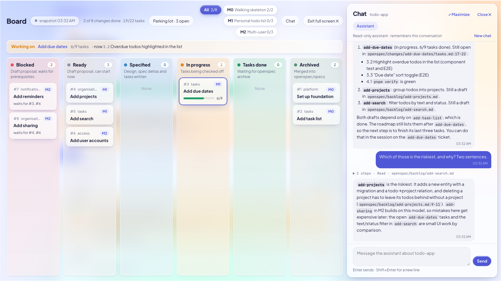
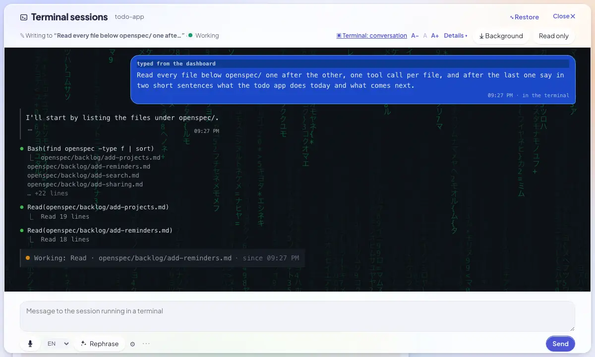
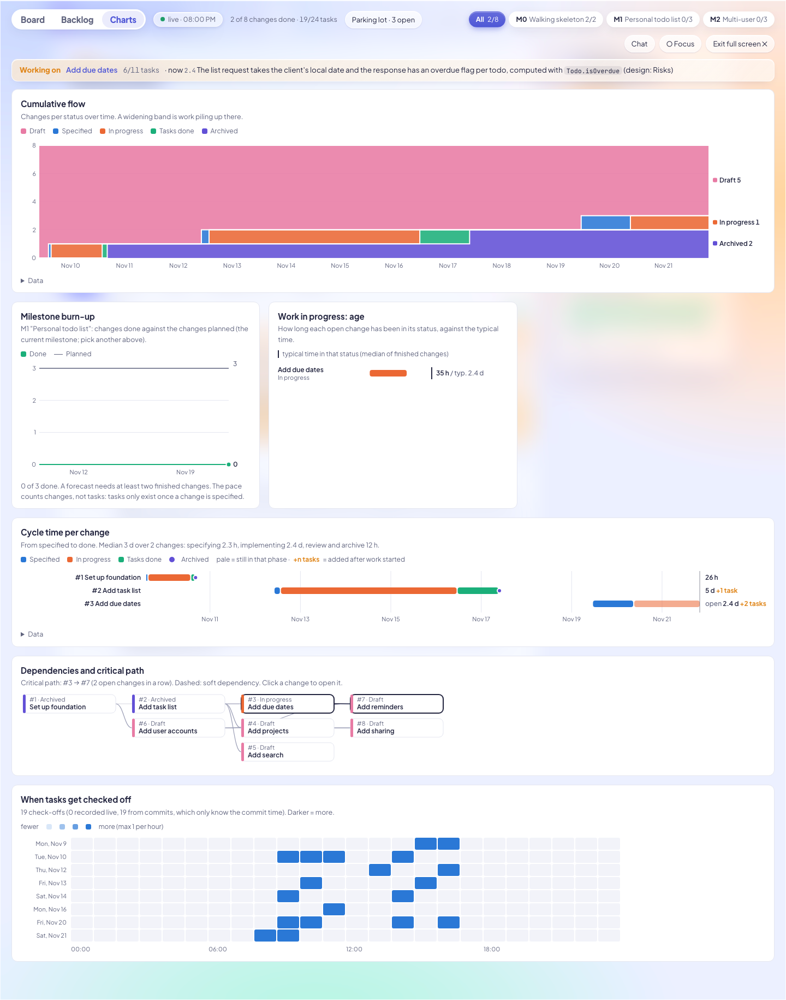
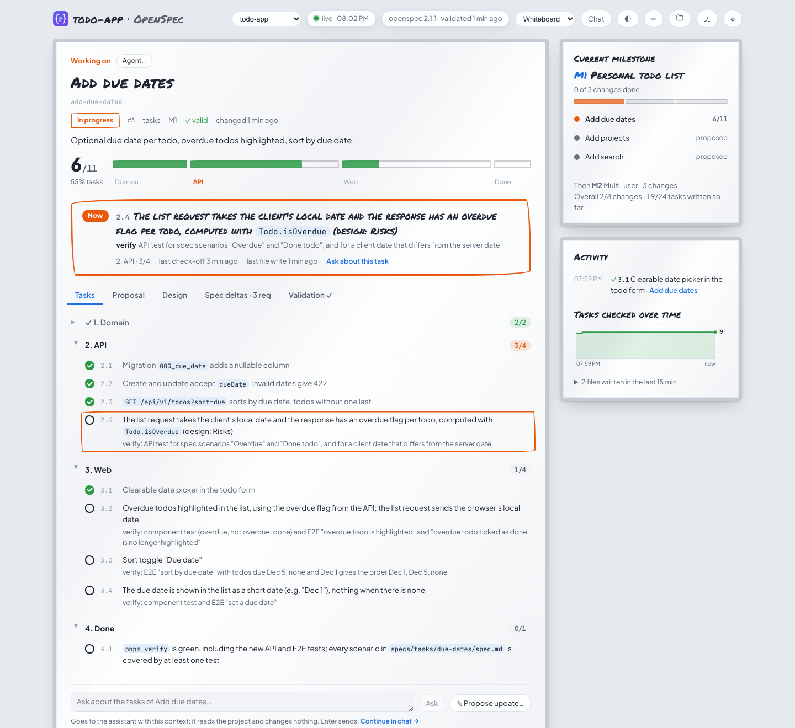
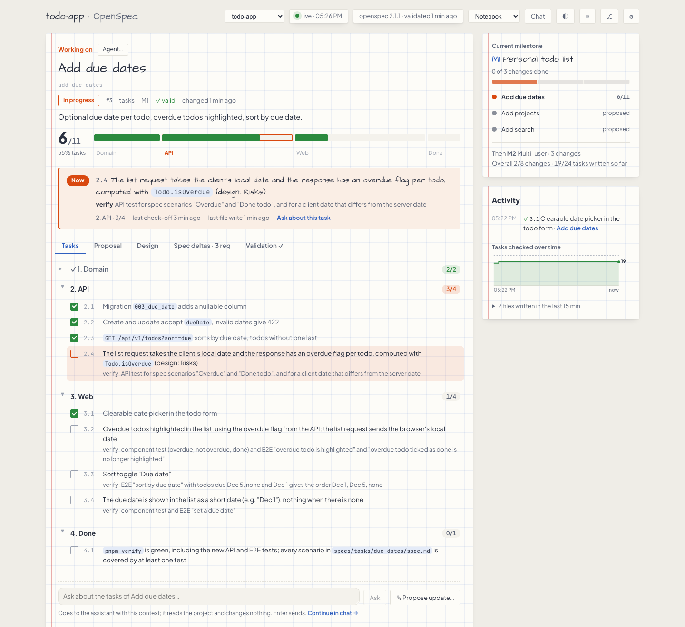
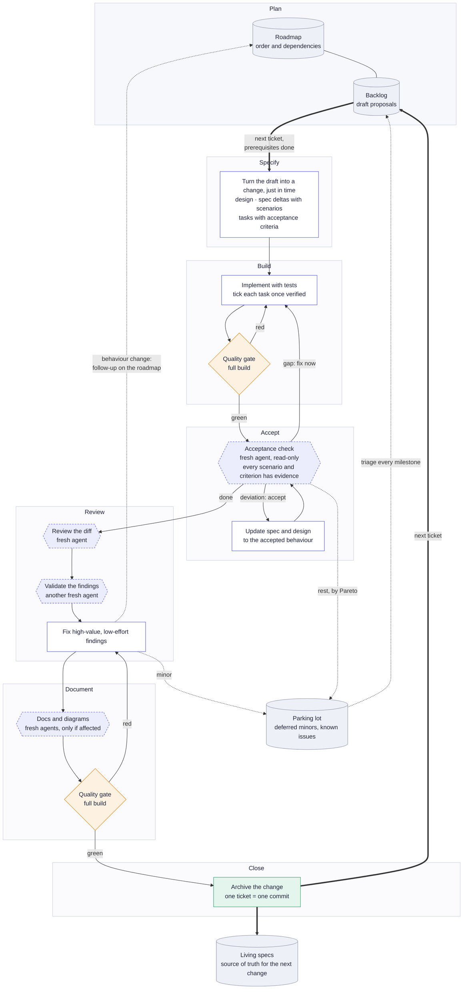
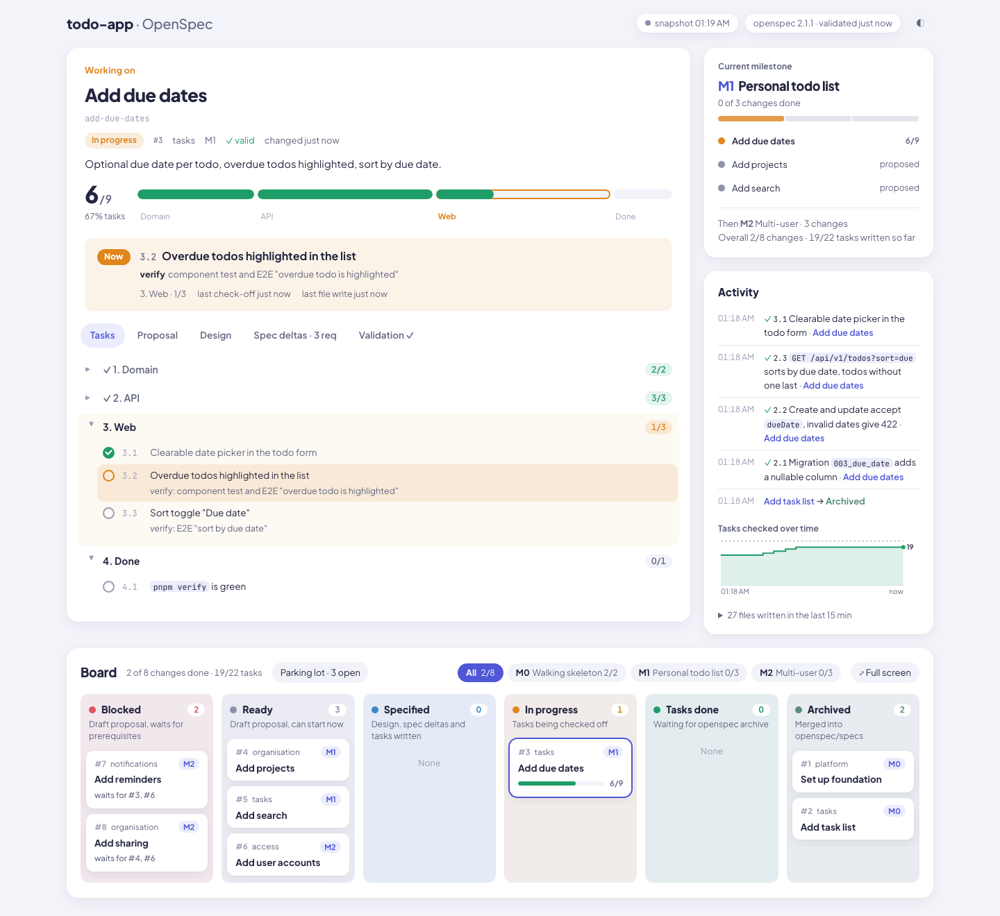
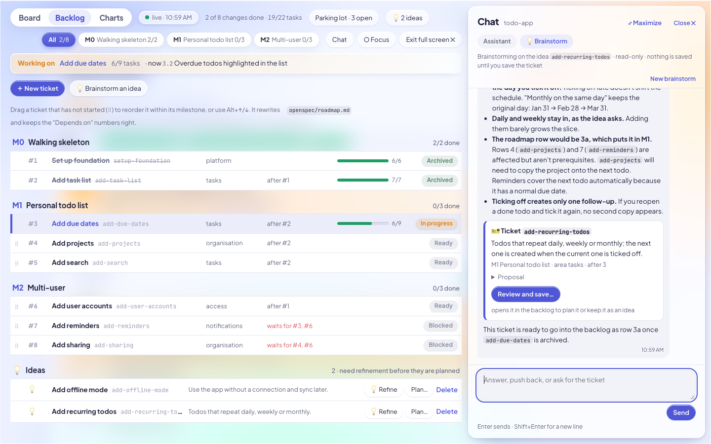

# OpenSpec ticket workflow

A reusable way to build software ticket by ticket with [OpenSpec](https://github.com/Fission-AI/OpenSpec) and
AI coding agents, from a draft in the backlog to an archived change and one commit. It does not depend on a
language, build tool or agent product: the **quality gate** is your project's full build, and a **fresh agent**
is any new session or sub-agent that has not seen the implementation.





*Writing to a running Claude Code session from the dashboard. The falling code only shows up during longer runs:
when an answer takes more than 30 seconds (adjustable, or off), it runs until the answer is in. The animation is
shortened.*



*Ten styles out of the box, most of them light and dark: from Flat and Glass to Paper, Blackboard or a
green-screen Terminal. Two of them, Whiteboard and Notebook (click for the [styles](docs/user-guide.md#styles) in the user guide):*

<p>
<a href="docs/user-guide.md#styles"></a>
<a href="docs/user-guide.md#styles"></a>
</p>

The repository contains:

- the workflow as diagrams ([Mermaid](diagrams/openspec-workflow.mmd), horizontal in
  [Mermaid](diagrams/openspec-workflow-horizontal.mmd) and [PlantUML](diagrams/openspec-workflow-horizontal-plantuml.puml),
  each rendered to SVG and PNG),
- an agent skill, [`openspec-ticket-workflow`](skills/openspec-ticket-workflow/SKILL.md), that runs a ticket
  through the workflow and sets it up in a new project, and a second one,
  [`openspec-dashboard`](skills/openspec-dashboard/SKILL.md), that starts, sets up and explains the dashboard.
- [`openspec-dashboard`](tools/openspec-dashboard/README.md), a live local dashboard to follow the progress of the
  changes while agents work on them, with a backlog, charts from the git history and a chat with Claude Code
  (see [below](#the-dashboard)).
- two sample OpenSpec contexts, [`examples/todo-app`](examples/todo-app) and
  [`examples/habit-tracker`](examples/habit-tracker), a [demo project with four weeks of history](examples/demo-history)
  to try the charts, and a short [user guide](docs/user-guide.md) with screenshots.

New here? Start with the [user guide](docs/user-guide.md).

## The workflow



Legend: rectangles are steps, diamonds are gates, dashed hexagons are fresh agents, cylinders carry work from one
ticket to the next. Dotted arrows show where deferred findings go.

Horizontal versions for slides and wide pages:
[Mermaid SVG](diagrams/openspec-workflow-horizontal.svg) ·
[Mermaid PNG](diagrams/openspec-workflow-horizontal.png) ·
[PlantUML SVG](diagrams/openspec-workflow-horizontal-plantuml.svg) ·
[PlantUML PNG](diagrams/openspec-workflow-horizontal-plantuml.png)

## Principles

- **One ticket = one OpenSpec change = one commit.** The change is archived in the commit that completes it, so
  the next change always builds on up-to-date specs.
- **Just in time.** Future work waits as short draft proposals in a backlog, ordered by a roadmap. Design, spec
  deltas and tasks are written when a ticket starts, with what earlier tickets taught you.
- **Every task says how it is verified.** Spec scenarios are the acceptance criteria; each task names its test,
  command or observable behaviour (`verify: …`).
- **Checks are done by fresh agents.** The agent that wrote the code does not accept, review or validate it.
  Review findings are confirmed by another agent before anyone acts on them.
- **Pareto.** Fix what is high value and low effort now. A behaviour change becomes a spec update plus a
  follow-up on the roadmap; minors go to a parking lot that is triaged at every milestone.
- **The gate never gets weaker.** No threshold is lowered to make a ticket pass.

## Steps and their OpenSpec support

| # | Phase | Step | OpenSpec |
|---|---|---|---|
| 1 | Specify | Create the change from its backlog draft; write design, spec deltas, tasks with `verify:` | `openspec new change`, `/openspec-continue-change`, `/openspec-ff-change`, `openspec validate` |
| 2 | Build | Implement with tests, tick each task once verified | `/openspec-apply-change` |
| 3 | Build | Quality gate | your build |
| 4 | Accept | Fresh agent checks every scenario and task criterion against evidence; deviations are recorded | `/openspec-verify-change`, `/openspec-update-change` |
| 5 | Review | Fresh agent reviews the staged diff only; optionally another fresh agent checks whether the quick way hurts the structure and maintainability in the long run | any agent |
| 6 | Review | Another fresh agent confirms or rejects each finding, classifies pareto / minor | any agent |
| 7 | Review | Fix pareto findings; route the rest to spec + roadmap, backlog draft or parking lot; a tactical shortcut goes to the parking lot as a trade-off, a harmful one is restructured or decided by the user | `/openspec-update-change` |
| 8 | Document | Fresh docs agent and diagram agent, only if docs are affected | any agent |
| 9 | Document | Quality gate | your build |
| 10 | Close | Archive the change and commit the ticket | `openspec archive`, `/openspec-archive-change` |

The slash commands are the agent skills that `openspec init` installs; names can differ between OpenSpec versions
and tools.

## Using the skills

Copy the skills into a project (or into your user-level skills directory):

```sh
cp -r skills/openspec-ticket-workflow <project>/.claude/skills/      # Claude Code, per project
cp -r skills/openspec-ticket-workflow ~/.claude/skills/              # Claude Code, all projects
cp -r skills/openspec-dashboard ~/.claude/skills/                    # the dashboard skill, the same way
```

Other agents that read [Agent Skills](https://agentskills.io) (`SKILL.md` with YAML front matter) can use the same
folder, e.g. under `.agents/skills/`.

Then ask the agent to set the workflow up ("set up the OpenSpec ticket workflow") or to run the next ticket. The
skill's references hold the pieces it uses:

- [config-snippet.yaml](skills/openspec-ticket-workflow/references/config-snippet.yaml): rules and guidance for
  `openspec/config.yaml`,
- [agent-prompts.md](skills/openspec-ticket-workflow/references/agent-prompts.md): prompts for the fresh agents
  (acceptance check, diff review, long-term check, findings validation, docs, diagrams),
- [templates.md](skills/openspec-ticket-workflow/references/templates.md): roadmap, backlog draft, idea and parking
  lot,
- [dashboard-messages.md](skills/openspec-ticket-workflow/references/dashboard-messages.md): what the reactions,
  requests, quotes and quick messages from the dashboard mean, so a session handles them the same way every time.

The [`openspec-dashboard`](skills/openspec-dashboard/SKILL.md) skill lets an agent start the dashboard for one or
more projects ("show me the OpenSpec dashboard"), install it as an app, connect a running session or find out why
something does not work; it points to the tool in this repository (`tools/openspec-dashboard/`).

## The dashboard

A live, local dashboard for following agents (or a team) through the tickets: one Node script and one HTML page,
no dependencies, no build, no install.

```sh
cd <your project>
node <path-to>/tools/openspec-dashboard/server.mjs          # add --agent to talk to Claude Code from it
```



What makes it more than a status page:

- **Live from the files.** Status is derived from `openspec/` itself, not from a tracker that drifts: the change
  being worked on, its *current task* with the `verify:` criterion, when the last task was checked off and when a
  file was last written, so you can tell whether the agent is still busy. Updates within a second.
- **Board, backlog and focus.** A board in six columns derived from the files, a backlog per milestone like an
  issue tracker (reorder untouched tickets by drag and drop; the dashboard rewrites the roadmap and keeps every
  dependency number right), and a focus mode that hides what is archived.
- **From idea to ticket.** Add a ticket from the backlog, planned at the end of a milestone and ready to start, or
  keep it as an idea that needs refinement. **Brainstorm** an idea with Claude in the chat: it asks, challenges and
  checks the roadmap for overlaps, and the ticket is saved only if you agree with the result.
- **Charts from the git history.** Cumulative flow, a milestone burn-up with a forecast, the age of open work
  against the typical time, the cycle time of every change split into specify, implement and review, the
  dependency graph with the critical path, and when tasks get checked off. They are rebuilt from `git log` of
  `openspec/`, so they cover the whole project, not just the time the dashboard ran.
- **Talk to the agent** (`--agent`). A chat with a read-only project assistant, Claude Code sessions started on a
  ticket from the dashboard, and messages to a session that is already working, also one in a terminal (through
  a hook). It runs your local `claude` command with its own login: no API key, same plan.
- **Edit the specs from a conversation.** Every tab of a change (tasks, proposal, design, spec deltas, validation)
  has its own question box with that context. When the conversation finds something to change, Claude proposes
  the updated file; you see a diff and accept or reject it.
- **Quick replies in the chat.** React to an answer with one click (👍 ✅ 🙏 🎉 💡; 🌿 accepts a proposal but on a
  new branch), ask for it again in simpler
  words (🔁), as a summary (📝) or as a table (📊), have it tried again (🔄), or quote it (↩, also just a selected
  part). Under the input box, one click asks a working session for its status (👀), blockers (❓), changes so far
  (🔍) or ticket progress (📍), has it pause after this step (⏸), stay on the ticket (🎯), wrap up (🧹) or run
  the quality gate (🧪), or has it commit (green arrow) or commit and push (blue arrow); while its folder has
  uncommitted files, those two arrows sit right next to ⚙. Claude gets a short
  reference to the answer, so it knows what you mean without the answer being sent again; the chat stays quiet
  with just a faint ⋯ until you hover an answer.
- **Voice and rephrasing, locally.** Dictate into any text box with a local speech-to-text container, and let a
  local model turn a rough draft into a clear prompt. Nothing of it goes to the cloud, and nothing is sent until
  you send it.
- **Several projects** at once with a live overview, and **onboarding** right from it: it finds folders with a
  `CLAUDE.md` or `AGENTS.md`, lets you chat with Claude about whether one is worth it, and sets up OpenSpec there
  in the background (nothing committed). Or **start a new project**: brainstorm it with Claude, and once you agree
  it is created with its roadmap and followed from then on (the agreed brief stays in the project as
  `openspec/brief.md`); an **expert mode** sets its quality gates, task checks,
  review topics, workflow steps, documentation, diagram format (Mermaid by default) and types, container engine,
  branches (main, per ticket or per milestone), version control (local, GitHub, GitLab, …, public or private) and
  license up front, takes attached files (a spec,
  notes, a PDF) as part of the idea,
  and lets Claude check your local containers for a service to reuse (e.g. a running Postgres) before anything is
  installed on the host. Projects you are done with can be **archived** or **unfollowed**, so they cost nothing
  while they rest.
- **Join a session running in a terminal** (the `>_` button in the header, also on the overview): pick it from a list of all
  running Claude Code sessions, follow what it does live (no setup needed), and write to it: in macOS Terminal the
  message is typed right into the session, also while it waits; elsewhere through a hook (one click). While you
  write, it can look like the CLI (terminal colors, steps as `⏺ Bash(…)` / `⎿ output`), offers the chat's quick
  replies (🌿 accepts a proposal on a new branch), and when an answer takes a while, **green code rains behind the
  conversation until it is done** — you see from across the room when it has finished. Long tasks go to the
  **background**: a header button lists them with their state (working, done, needs you, an issue). Sessions in other projects
  switch there; one in a folder that is not followed yet can be followed on its own and onboarded with one click.
- **Git history** of the project: the commits with a graph of branches, tags and remote branches, and each commit's
  message, files and diff, read-only; **openspec/ only** shows just the commits that changed the specs. A dot on
  its button marks uncommitted changes, and another button opens the project folder in your file manager
  (configurable).
- **Ten styles**, from Flat and Glass to Clay, Paper, Blackboard or a green-screen Terminal.
- **An app of its own**: `launcher.mjs install` puts the dashboard with its logo into Launchpad and the Dock
  (macOS) or the application menu (Linux); one click starts it if needed and opens it. Installed as a web app it
  gets its own Dock icon, and `--service` keeps the dashboard running from login on.



Details: the [user guide](docs/user-guide.md) and the dashboard [README](tools/openspec-dashboard/README.md).

## Rendering the diagrams

The diagrams render in containers, so neither Node nor Java is needed:

```sh
./render-diagrams.sh
```

It uses `ghcr.io/mermaid-js/mermaid-cli/mermaid-cli` and `docker.io/plantuml/plantuml` with podman
(override with `MERMAID_IMAGE` / `PLANTUML_IMAGE`).

## License

[Apache License 2.0](LICENSE)
