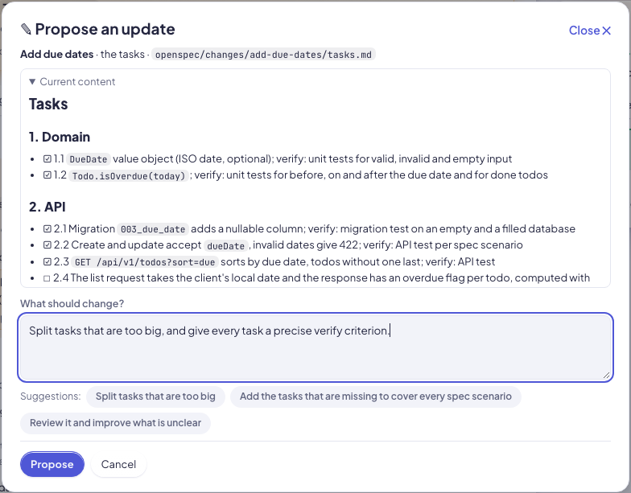
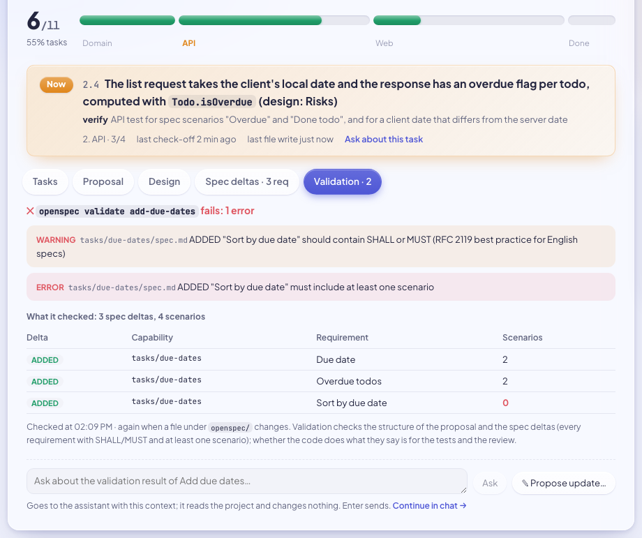
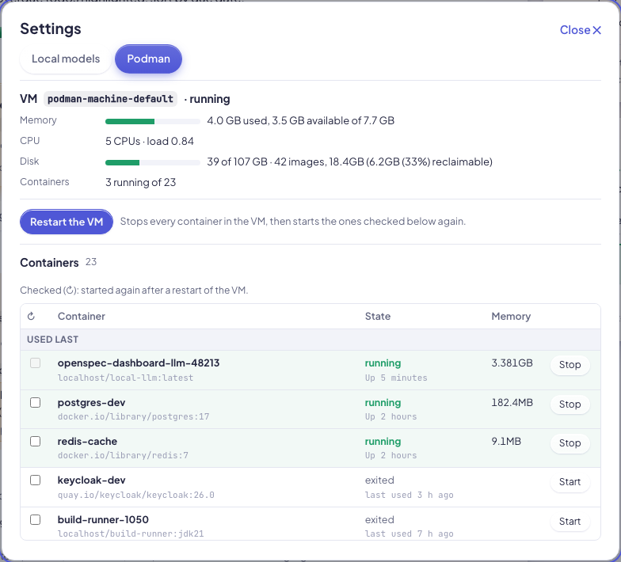
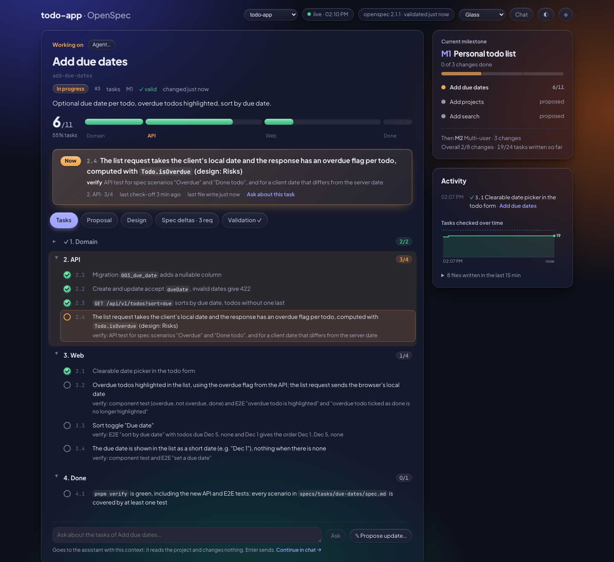
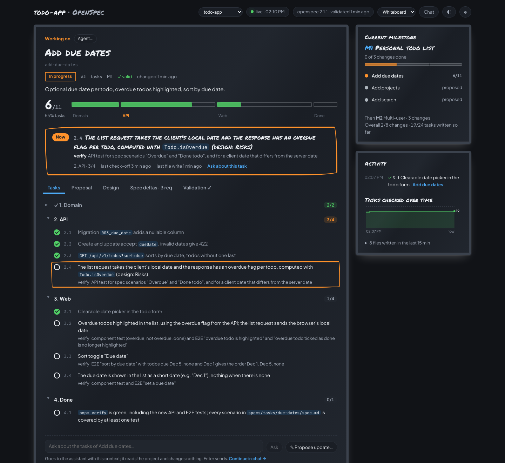
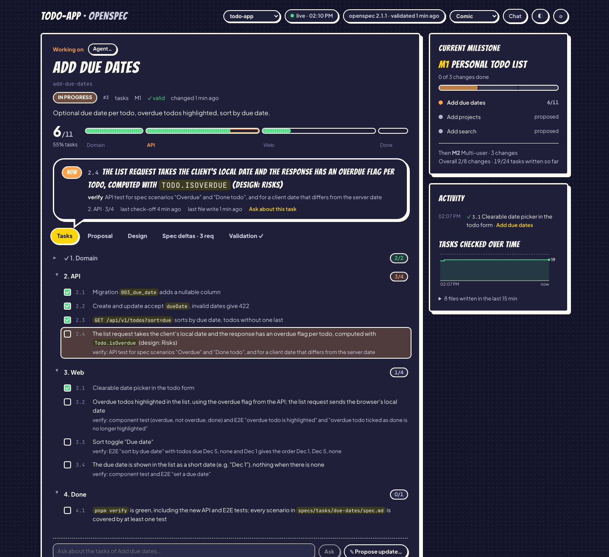

# User guide

This guide takes you from the sample to your own project in four steps: look at the sample, set up the workflow,
run tickets with an agent, and follow the progress on the dashboard. You need Node 20+, an agent that reads
skills (e.g. Claude Code) and the [OpenSpec](https://github.com/Fission-AI/OpenSpec) CLI. Rendering the diagrams
also needs podman.

## 1. Look at the sample

[`examples/todo-app`](../examples/todo-app) is the OpenSpec context of a small todo app in the middle of its first
milestone ([`examples/habit-tracker`](../examples/habit-tracker) is a second, smaller one). It has no code, only
`openspec/`:

| Path | What it shows |
|---|---|
| `openspec/config.yaml` | project context, the rules for proposals, specs and tasks, and the ticket workflow as agent guidance |
| `openspec/roadmap.md` | eight changes in order, with prerequisites and three milestones |
| `openspec/backlog/` | drafts of the five changes that have not started |
| `openspec/changes/add-due-dates/` | the ticket in progress: proposal, design, spec deltas, tasks with `verify:` criteria, 6 of 11 done |
| `openspec/changes/archive/` | two finished tickets, archived in the commit that completed them |
| `openspec/specs/` | the living specs those two tickets produced |
| `openspec/changes/parking-lot/` | deferred review minors, known issues and trade-offs |

Start the dashboard on it:

```sh
cd examples/todo-app
node ../../tools/openspec-dashboard/server.mjs
```

It opens http://127.0.0.1:4590/. With `openspec` on your `PATH` it also shows the validation result per change;
without it, add `--no-cli`.

## 2. Set up your project

Copy the skill into your project and let the agent set the workflow up:

```sh
cp -r skills/openspec-ticket-workflow <your project>/.claude/skills/
```

Then ask the agent, in your project:

> Set up the OpenSpec ticket workflow. The quality gate is `pnpm verify`.

The agent merges the workflow into `openspec/config.yaml`, creates `openspec/roadmap.md`, a draft per planned
change in `openspec/backlog/` and the parking-lot change, and adds one line to your agent instructions. Write or
review the roadmap yourself: its order and the *Depends on* column decide what can start when.

## 3. Run tickets

Ask for the next ticket, or name one:

> Run the next ticket.
> Run `add-due-dates`.

The agent works through the ten steps of the [workflow](../README.md#the-workflow): it elaborates the change, implements it
with tests, runs the quality gate, has fresh agents check acceptance, review the diff and validate the findings,
fixes what is worth fixing, updates the docs, runs the gate again, then archives the change and makes one commit.
At the end it reports the result and the next ticket the roadmap allows.

You stay in control of three things:

- **The roadmap**: order, prerequisites, milestones. Candidates found during tickets are added there for you to plan.
- **Deviations**: when the acceptance check finds that the built behaviour differs from a scenario, the agent
  either fixes it or records it in the spec; read those spec updates.
- **The parking lot**: triage it at every milestone and promote items to real changes.

## 4. Follow the progress

Start the dashboard in your project (`node <path-to>/tools/openspec-dashboard/server.mjs`) and keep it open while
the agent works. It updates within a second of every file change. The screenshots show the **Glass** style; see
[Styles](#styles) for the others.


- **Working on** shows the change in progress and the **current task**, the first unchecked one, with its
  `verify:` criterion. Below it: when the last task was checked off and when a project file was last written, so
  you can tell whether the agent is still busy.
- The progress bar has one segment per task group; the group with the current task is outlined.
- The tabs show the proposal, design, spec deltas and the `openspec validate` result of the change (see
  [Validation](#validation) below). With `--agent`, every tab has a question box below its content: the question
  goes to the assistant with that context (e.g. "the design of add-due-dates" and its file), and the answer shows
  right there (**Ask** works once there is a question); **Continue in chat** opens the whole conversation.


  When something should change, **✎ Propose update…** (next to Ask) opens a dialog for that tab: it shows the change,
  the file and its current content, and asks what should change (suggestions fill it in, e.g. "Split tasks that
  are too big"; if you discussed the tab below it, that can be taken into account). **Propose** asks Claude for an
  updated version of the file.



  The proposal shows as a diff (removed lines red, added lines green, unchanged ones folded), in the dialog and
  below the tab; **Accept** writes the file, **Reject** leaves it as it is. Claude itself never writes: only Accept
  does, and only if the file has not changed since the preview (otherwise you get a new preview). This also works
  in the chat, when you ask Claude there to change a file.


- **Current milestone** lists the other changes of the milestone; **Activity** lists every checked-off task and
  status change since the dashboard started, with a chart of tasks done over time.
- The **Board** shows every change in the column its files put it in. "Waits for #3, #6" names the unfinished
  prerequisites. The parking lot is the chip next to the counts.

### Validation

The **Validation** tab shows what `openspec validate` says about the change, and what it checked. It matters from
the moment a change is specified (design, spec deltas and tasks written) until it is archived: a draft in
`openspec/backlog/` is not an OpenSpec change yet, and an archived change is part of `openspec/specs/`, so the tab
says that instead of a result.

For a change that passes, the tab lists every spec delta the CLI checked: the operation (ADDED, MODIFIED, REMOVED),
the capability, the requirement and how many scenarios it has.


When it fails, errors come first, then warnings and notes, each with the spec file it is about; a requirement
without a scenario shows a red **0** in the table. The tab is labelled **Validation · 2** (the number of issues),
and the change's card on the board says "✕ validation fails", so a broken spec delta is visible without opening
it.



Validation checks the structure: a proposal, requirements written with SHALL or MUST, at least one scenario per
requirement. Whether the code does what the scenarios say is for the tests and the review. The dashboard runs the
CLI again whenever a file under `openspec/` changes, and the tab says when it last checked, or what the CLI is busy
with.

### Board

**⤢ Full screen** shows only the board, still live, with the current change and task in a line at the top:


Click a card to open its details next to the board; `Esc` closes them. A link to a card's details is
`#board:<change>`, e.g. http://127.0.0.1:4590/#board:add-due-dates:


**○ Focus** hides the archived changes and folds empty columns into narrow strips, so the open work gets the space
(`?focus` in a link):


**Backlog** shows the roadmap as a list per milestone, like the backlog of an issue tracker. The change you opened
last stays highlighted, so you find your place in the list again. With `--agent` you can reorder the changes that
have not started: drag one by its handle (⠿) within its milestone, or use Alt+↑/↓. The dashboard rewrites
`openspec/roadmap.md`, keeps the numbers of the positions and updates every *Depends on* reference; it refuses a
move that would put a change before one of its prerequisites.


With `--agent` the backlog also takes new work. **＋ New ticket** opens a form for the draft and its roadmap entry:
**Add to roadmap** plans it at the end of the chosen milestone, ready to start; **Save as idea** keeps it as a draft
that still needs refinement, listed under **Ideas** at the end of the backlog and nowhere else.


**💡 Brainstorm an idea** (or **Refine** on an idea) starts a brainstorming conversation in the chat. Claude asks
questions, checks the roadmap and the specs for overlaps and prerequisites, and keeps the ticket small; when you
agree, it writes the ticket as a card. **Review and save…** opens it in the form, where you plan it or keep it as an
idea. If the brainstorming does not lead anywhere, nothing is saved.


**Charts** shows how the work flows: a cumulative flow diagram, a burn-up of the milestone with a forecast, the
age of open changes against the typical time, the cycle time of each change split into its phases, the
dependency graph with the critical path, and when tasks get checked off. The milestone picked above filters them.
They are built from the git history of `openspec/` and from what the dashboard recorded while it ran, so they also
cover the time before you first started it; hover for values, **Data** shows a table. **○ Focus** shows open work
only: no archived band in the flow, no archived changes in the cycle times and the dependency graph.


## Talk to the agent (optional)

Start the dashboard with `--agent` to chat with Claude about the project, start a session on a ticket and talk to
it while it works. It runs your local Claude Code (the `claude` command) with its own login; there is no extra key.

```sh
node tools/openspec-dashboard/server.mjs --agent examples/todo-app
```

**Chat** (in the header and on the full-screen board) is a messenger, independent of any ticket. The
**Assistant** reads the project but never changes it, knows its status and remembers the conversation; **New chat**
starts over. Every session started from the dashboard becomes a conversation of its own, and **Terminal session**
sends messages to a session running elsewhere. Enter sends, Shift+Enter starts a new line.


**⤢ Maximize** gives the chat the whole window; `Esc` brings the side panel back.


**Quick replies.** Each of Claude's answers has a faint **⋯** next to its time. Move the mouse over the answer (or
tap ⋯) and a row of buttons appears:

- 👍 ✅ 🙏 🎉 💡 react at once, each with a short sentence ("I agree with this.", "Yes, go ahead with this.",
  "Thanks, that helps.", "Great, that is exactly right.", "Good idea, let us keep that."); only positive ones;
- 🔁 asks for the answer again in simpler words, 📝 for a summary in a few bullet points, 📊 for an overview table;
- ↩ quotes the answer in your next message; select a part of it first to quote just that part.

Claude gets the answer's first sentence (or the part you selected) as the reference, so it knows which answer you
mean even when the conversation has moved on, without the whole answer being sent again. Reactions show as small
badges on the answer, quotes as a quote above your text.


**Agent…** on a ticket adds the ticket's context automatically: **Ask** a read-only question about it ("Ask about
this task" next to the current task prefills one), or **Start session** to let a new session work on it with the
ticket workflow. The session then shows up in the chat, where you follow its steps, send it messages, end or stop
it, and continue it later.


Before the first session:

- Allow what the workflow needs (the quality gate, `openspec`, `git add`/`git commit`) in the project's
  `.claude/settings.json`: nobody can answer permission prompts in a started session, so they are declined.
- Run `claude` in the project folder once and accept the trust dialog; until then Claude Code ignores the
  project's permission rules (the panel warns about it).
- For a session running in a terminal, install the hook once so it receives messages:
  `node tools/openspec-dashboard/agent-hook.mjs install <project>`.

**Voice input**: if Podman has a speech-to-text image (whisper.cpp's `whisper-cli` with a model), the text boxes get
a microphone. Click it, speak, click **Stop**: the recording is transcribed locally in that container, and the text
lands in the box for you to check before you send it. Pick the language you speak next to it; that is much faster
than **Auto**.

**Rephrase**: with a local language model (an OpenAI-compatible server given with `--rephrase-url`, or a Podman image
with an LLM adapter), **✨ Rephrase** turns a rough draft into a clear prompt: to the point, nothing important
dropped, in the language you wrote. It shows a suggestion; **Accept** replaces your text, **Reject** keeps it. On a
CPU the first request waits until the model has loaded.

**⚙ Settings** (in the header, and next to Rephrase) shows the models in use, with the matching option and its image
and model filled in. With **Choose automatically** the dashboard picks them; untick it to keep that setup fixed or to
choose: for Rephrase a container with its image and model, a local server such as Ollama or LM Studio (URL and model name),
Apple's on-device model on macOS 26 with Apple Intelligence, or off; for speech-to-text the whisper image, or off.
**Test** tries the setting with a sample sentence, **Load now** starts a container model before you need it.


The **Podman** tab of the same dialog shows how the Podman VM is doing (memory, CPU load, disk) and its containers:
the 15 used last at the top (running ones first), then all others by name, each with a **Start** or **Stop**
button. When the VM is stuck or full, **Restart the VM** stops and starts it; the containers you checked (↻) come
back, the others stay stopped. The dashboard's own model container cannot be checked: it is removed when it stops
and started again on the next request.



Every question, chat message and session is a normal Claude Code run and counts towards your plan. Details:
[dashboard README](../tools/openspec-dashboard/README.md#agent-panel-optional).

## Several projects

Pass several projects, or `--scan` a folder, and the dashboard starts with an overview of all of them:

```sh
node tools/openspec-dashboard/server.mjs --scan=examples            # add --agent for onboarding (below)
```


Each card shows the change being worked on and its current task, the task progress, the mix of statuses (the
coloured bar), the current milestone, validation problems and when something last happened; the most recently
active project comes first and the cards update live. Click a card, or pick the project in the header, to open its
dashboard; **All projects** in the picker returns to the overview.

### Onboard more projects

With `--agent`, the overview also finds projects to onboard (the lower half of the screenshot above). Enter a folder
under **Onboard more projects** and press **Discover**: it lists the folders below it with a `CLAUDE.md` or
`AGENTS.md` that the dashboard does not follow yet, with the first line of their README and their last commit. A
folder that has `openspec/` already gets **Follow**.

**Onboard** lets Claude set up OpenSpec and the ticket workflow in that project in the background (nothing is
committed; check the result in git), and adds the project to the dashboard when it is done. Not sure? **Chat about
it** first: Claude looks at the project read-only and recommends onboarding it or not. Then press **Onboard it**,
or **Skip → next candidate** to move on to the next one.


### Start a new project

**＋ Start a new project** (on the right of the "Onboard more projects" heading in the screenshot above) brainstorms a
project that does not exist yet. It opens full screen; **⤡ Restore** (or `Esc`) shrinks it to a side panel, and the
choice is remembered. Choose the folder it
goes into and describe the idea; Claude asks about the problem, the users, the scope of a first version, the stack
and the quality gate, and proposes a first milestone of tickets. Once you agree it shows the project as a card.
**Create project…** asks for the folder name; **Create and set up** creates the folder and lets Claude write
`CLAUDE.md`, the README and the OpenSpec setup with the roadmap from the brainstorming, in the background and without
committing. From then on the dashboard follows the project, also after a restart; its first ticket sets up the
skeleton.


**⚙ Expert mode** (next to the folder) sets the workflow the new project starts with, as toggle chips with sensible
defaults; **+ add** takes your own entries:

- **Quality gates**: build and unit tests, linting, type checks, integration and end-to-end tests, coverage,
  mutation testing, architecture rules, vulnerability and license scans, performance budgets;
- **Checked for every task**: e.g. a test proves it, the quality gate is green, no TODOs;
- **Reviewed for every change**: e.g. matches the specs, security, error handling, test quality, accessibility,
  API compatibility, migrations;
- **Workflow steps**: one commit per ticket, acceptance check, diff review with validated findings, docs and
  diagram updates, parking lot.

Claude gets them with your next message and plans with them (the first ticket sets up the chosen gates). **Create**
makes them binding: they go into the project's `openspec/config.yaml` (the quality gate, the rules for tasks, what
every review covers) and its CLAUDE.md. Your choices are remembered for the next project.


## Styles

The dashboard has ten styles:

| Style | Look |
|---|---|
| **Flat** (default) | clean and quiet |
| **Glass** | frosted panels over a soft colour field |
| **Clay** | warm ivory and terracotta with serif headings, close to the look of Claude; warm charcoal in dark mode |
| **Paper** | post-its on light wooden boards, one colour per column, the current task on a sticky note |
| **Whiteboard** | marker on a framed whiteboard, cards held by magnets; a dark glass board in dark mode |
| **Blackboard** | chalk on a green board in a wooden frame; always dark |
| **Notebook** | squared paper with a red margin line, handwritten headings, quiet cards |
| **Matrix** | falling green code behind glowing panels; always dark; the rain stops with reduced motion |
| **Terminal** | retro green-screen CRT with scanlines and a blinking cursor; always dark |
| **Comic** | halftone dots, thick ink outlines, the current task in a speech bubble |

The style picker in the header switches the style, ◐ switches light and dark; both choices are remembered per
browser. In a link, `?style=<name>` (lower case, e.g. `notebook`) and `?theme=light|dark` set them, e.g.
http://127.0.0.1:4590/?style=paper&theme=dark.

| Flat, light | Flat, dark | Glass, dark |
|---|---|---|
|  |  |  |

| Clay, light | Clay, dark |
|---|---|
|  |  |

| Paper, light | Paper, dark |
|---|---|
|  |  |
|  |  |

| Whiteboard, light | Whiteboard, dark |
|---|---|
|  |  |
|  | |

| Blackboard | Blackboard, board in full screen |
|---|---|
|  |  |

| Notebook, light | Notebook, dark |
|---|---|
|  |  |

| Matrix | Terminal |
|---|---|
|  |  |

| Comic, light | Comic, dark |
|---|---|
|  |  |

## Tips

- If OpenSpec runs in a container or behind a wrapper, start the dashboard with `--cli=<wrapper>`.
- The dashboard never writes to your project, except with `--agent` when you reorder the backlog or save a
  ticket or an idea. Its history
  lives in `~/.local/state/openspec-dashboard/`.
- Ticket by ticket, `openspec/specs/` becomes the description of what the system does today; point new team
  members and new agents there first.
- More options: [dashboard README](../tools/openspec-dashboard/README.md). The skill itself:
  [SKILL.md](../skills/openspec-ticket-workflow/SKILL.md).
