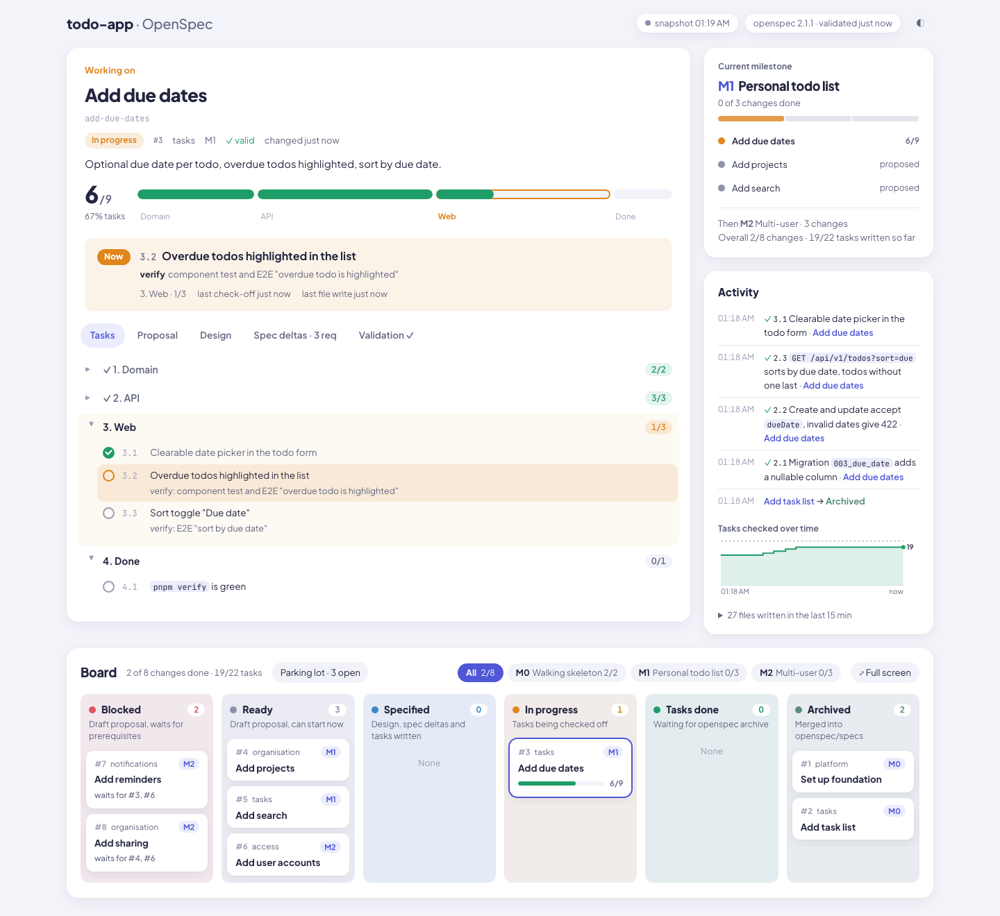
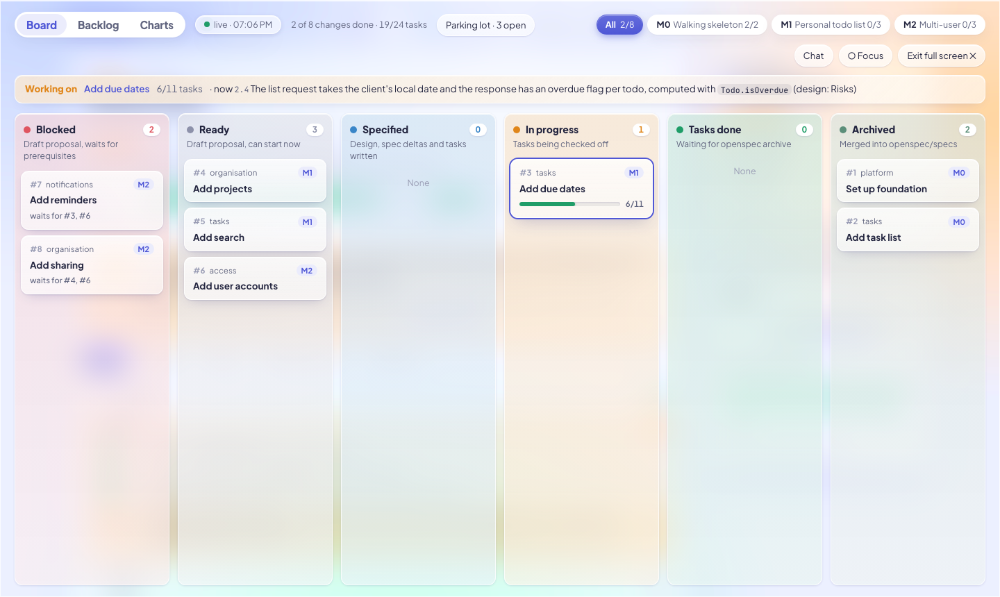
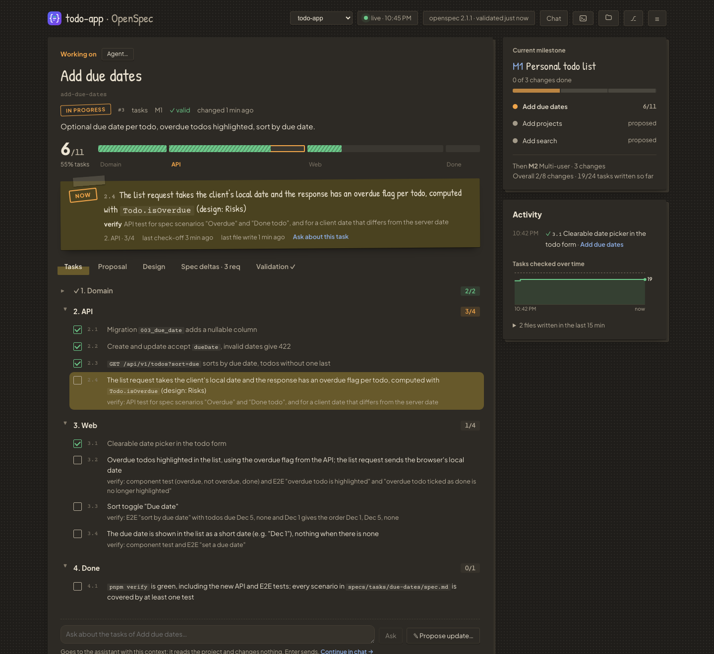
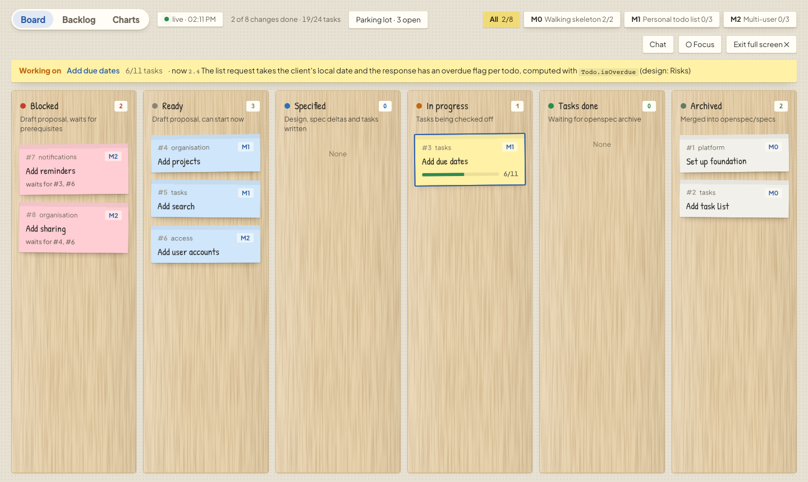
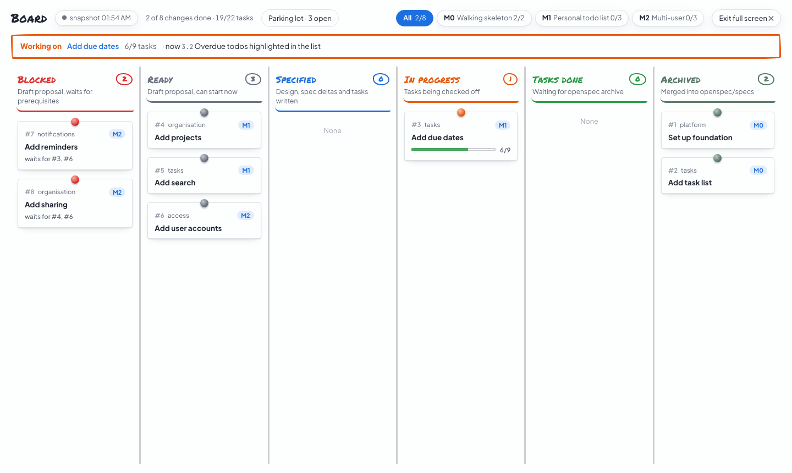

# User guide

This guide takes you from the sample to your own project in four steps: look at the sample, set up the workflow,
run tickets with an agent, and follow the progress on the dashboard. You need Node 20+, an agent that reads
skills (e.g. Claude Code) and the [OpenSpec](https://github.com/Fission-AI/OpenSpec) CLI. Rendering the diagrams
also needs podman.

## 1. Look at the sample

[`examples/todo-app`](../examples/todo-app) is the OpenSpec context of a small todo app in the middle of its first
milestone. It has no code, only `openspec/`:

| Path | What it shows |
|---|---|
| `openspec/config.yaml` | project context, the rules for proposals, specs and tasks, and the ticket workflow as agent guidance |
| `openspec/roadmap.md` | eight changes in order, with prerequisites and three milestones |
| `openspec/backlog/` | drafts of the five changes that have not started |
| `openspec/changes/add-due-dates/` | the ticket in progress: proposal, design, spec deltas, tasks with `verify:` criteria, 6 of 9 done |
| `openspec/changes/archive/` | two finished tickets, archived in the commit that completed them |
| `openspec/specs/` | the living specs those two tickets produced |
| `openspec/changes/parking-lot/` | deferred review minors, known issues and trade-offs |

Start the dashboard on it:

```sh
cd examples/todo-app
node ../../tools/openspec-dashboard/server.mjs
```

It opens http://127.0.0.1:4590/. With `openspec` on your `PATH` it also shows the validation result per change;
without it, add `--no-cli`.

## 2. Set up your project

Copy the skill into your project and let the agent set the workflow up:

```sh
cp -r skills/openspec-ticket-workflow <your project>/.claude/skills/
```

Then ask the agent, in your project:

> Set up the OpenSpec ticket workflow. The quality gate is `pnpm verify`.

The agent merges the workflow into `openspec/config.yaml`, creates `openspec/roadmap.md`, a draft per planned
change in `openspec/backlog/` and the parking-lot change, and adds one line to your agent instructions. Write or
review the roadmap yourself: its order and the *Depends on* column decide what can start when.

## 3. Run tickets

Ask for the next ticket, or name one:

> Run the next ticket.
> Run `add-due-dates`.

The agent works through the ten steps of the [workflow](../README.md#the-workflow): it elaborates the change, implements it
with tests, runs the quality gate, has fresh agents check acceptance, review the diff and validate the findings,
fixes what is worth fixing, updates the docs, runs the gate again, then archives the change and makes one commit.
At the end it reports the result and the next ticket the roadmap allows.

You stay in control of three things:

- **The roadmap**: order, prerequisites, milestones. Candidates found during tickets are added there for you to plan.
- **Deviations**: when the acceptance check finds that the built behaviour differs from a scenario, the agent
  either fixes it or records it in the spec; read those spec updates.
- **The parking lot**: triage it at every milestone and promote items to real changes.

## 4. Follow the progress

Start the dashboard in your project (`node <path-to>/tools/openspec-dashboard/server.mjs`) and keep it open while
the agent works. It updates within a second of every file change. The screenshots show the **Glass** style; see
[Styles](#styles) for the others.



- **Working on** shows the change in progress and the **current task**, the first unchecked one, with its
  `verify:` criterion. Below it: when the last task was checked off and when a project file was last written, so
  you can tell whether the agent is still busy.
- The progress bar has one segment per task group; the group with the current task is outlined.
- The tabs show the proposal, design, spec deltas and the `openspec validate` result of the change.
- **Current milestone** lists the other changes of the milestone; **Activity** lists every checked-off task and
  status change since the dashboard started, with a chart of tasks done over time.
- The **Board** shows every change in the column its files put it in. "Waits for #3, #6" names the unfinished
  prerequisites. The parking lot is the chip next to the counts.

**⤢ Full screen** shows only the board, still live, with the current change and task in a line at the top:



Click a card to open its details next to the board; `Esc` closes them. A link to a card's details is
`#board:<change>`, e.g. http://127.0.0.1:4590/#board:add-due-dates:


## Styles

The dashboard has five styles: **Flat** (the default), **Glass** (frosted panels over a soft colour field),
**Paper** (post-its on light wooden boards, one colour per column, the current task on a sticky note),
**Whiteboard** (marker on a framed whiteboard, cards held by magnets; a dark glass board in dark mode) and
**Blackboard** (chalk on a green board in a wooden frame; always dark). The style picker in the header switches
the style, ◐ switches light and dark; both choices are remembered per browser.
In a link, `?style=flat|glass|paper|whiteboard|blackboard` and `?theme=light|dark` set them, e.g.
http://127.0.0.1:4590/?style=paper&theme=dark.

| Flat, light | Flat, dark | Glass, dark |
|---|---|---|
|  |  |  |

| Paper, light | Paper, dark |
|---|---|
|  |  |
|  |  |

| Whiteboard, light | Whiteboard, dark |
|---|---|
|  |  |
|  | |

| Blackboard | Blackboard, board in full screen |
|---|---|
|  |  |

## Tips

- If OpenSpec runs in a container or behind a wrapper, start the dashboard with `--cli=<wrapper>`.
- The dashboard never writes to your project. Its history lives in `~/.local/state/openspec-dashboard/`.
- Ticket by ticket, `openspec/specs/` becomes the description of what the system does today; point new team
  members and new agents there first.
- More options: [dashboard README](../tools/openspec-dashboard/README.md). The skill itself:
  [SKILL.md](../skills/openspec-ticket-workflow/SKILL.md).
