# User guide

This guide takes you from the sample to your own project in four steps: look at the sample, set up the workflow,
run tickets with an agent, and follow the progress on the dashboard. You need Node 20+, an agent that reads
skills (e.g. Claude Code) and the [OpenSpec](https://github.com/Fission-AI/OpenSpec) CLI. Rendering the diagrams
also needs podman.

## 1. Look at the sample

[`examples/todo-app`](../examples/todo-app) is the OpenSpec context of a small todo app in the middle of its first
milestone ([`examples/habit-tracker`](../examples/habit-tracker) is a second, smaller one). It has no code, only
`openspec/`:

| Path | What it shows |
|---|---|
| `openspec/config.yaml` | project context, the rules for proposals, specs and tasks, and the ticket workflow as agent guidance |
| `openspec/roadmap.md` | eight changes in order, with prerequisites and three milestones |
| `openspec/backlog/` | drafts of the five changes that have not started |
| `openspec/changes/add-due-dates/` | the ticket in progress: proposal, design, spec deltas, tasks with `verify:` criteria, 6 of 9 done |
| `openspec/changes/archive/` | two finished tickets, archived in the commit that completed them |
| `openspec/specs/` | the living specs those two tickets produced |
| `openspec/changes/parking-lot/` | deferred review minors, known issues and trade-offs |

Start the dashboard on it:

```sh
cd examples/todo-app
node ../../tools/openspec-dashboard/server.mjs
```

It opens http://127.0.0.1:4590/. With `openspec` on your `PATH` it also shows the validation result per change;
without it, add `--no-cli`.

## 2. Set up your project

Copy the skill into your project and let the agent set the workflow up:

```sh
cp -r skills/openspec-ticket-workflow <your project>/.claude/skills/
```

Then ask the agent, in your project:

> Set up the OpenSpec ticket workflow. The quality gate is `pnpm verify`.

The agent merges the workflow into `openspec/config.yaml`, creates `openspec/roadmap.md`, a draft per planned
change in `openspec/backlog/` and the parking-lot change, and adds one line to your agent instructions. Write or
review the roadmap yourself: its order and the *Depends on* column decide what can start when.

## 3. Run tickets

Ask for the next ticket, or name one:

> Run the next ticket.
> Run `add-due-dates`.

The agent works through the ten steps of the [workflow](../README.md#the-workflow): it elaborates the change, implements it
with tests, runs the quality gate, has fresh agents check acceptance, review the diff and validate the findings,
fixes what is worth fixing, updates the docs, runs the gate again, then archives the change and makes one commit.
At the end it reports the result and the next ticket the roadmap allows.

You stay in control of three things:

- **The roadmap**: order, prerequisites, milestones. Candidates found during tickets are added there for you to plan.
- **Deviations**: when the acceptance check finds that the built behaviour differs from a scenario, the agent
  either fixes it or records it in the spec; read those spec updates.
- **The parking lot**: triage it at every milestone and promote items to real changes.

## 4. Follow the progress

Start the dashboard in your project (`node <path-to>/tools/openspec-dashboard/server.mjs`) and keep it open while
the agent works. It updates within a second of every file change. The screenshots show the **Glass** style; see
[Styles](#styles) for the others.


- **Working on** shows the change in progress and the **current task**, the first unchecked one, with its
  `verify:` criterion. Below it: when the last task was checked off and when a project file was last written, so
  you can tell whether the agent is still busy.
- The progress bar has one segment per task group; the group with the current task is outlined.
- The tabs show the proposal, design, spec deltas and the `openspec validate` result of the change.
- **Current milestone** lists the other changes of the milestone; **Activity** lists every checked-off task and
  status change since the dashboard started, with a chart of tasks done over time.
- The **Board** shows every change in the column its files put it in. "Waits for #3, #6" names the unfinished
  prerequisites. The parking lot is the chip next to the counts.

**⤢ Full screen** shows only the board, still live, with the current change and task in a line at the top:


Click a card to open its details next to the board; `Esc` closes them. A link to a card's details is
`#board:<change>`, e.g. http://127.0.0.1:4590/#board:add-due-dates:


**○ Focus** hides the archived changes and folds empty columns into narrow strips, so the open work gets the space
(`?focus` in a link):

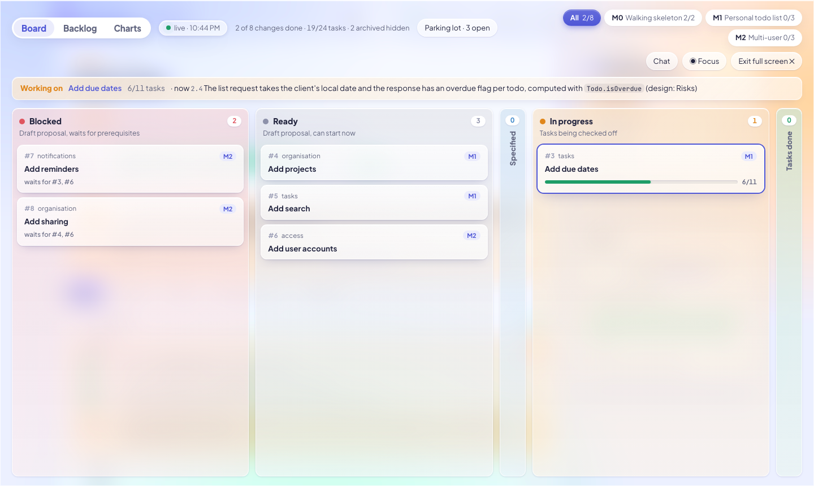

**Backlog** shows the roadmap as a list per milestone, like the backlog of an issue tracker. The change you opened
last stays highlighted, so you find your place in the list again. With `--agent` you can reorder the changes that
have not started: drag one by its handle (⠿) within its milestone, or use Alt+↑/↓. The dashboard rewrites
`openspec/roadmap.md`, keeps the numbers of the positions and updates every *Depends on* reference; it refuses a
move that would put a change before one of its prerequisites.


**Charts** shows how the work flows: a cumulative flow diagram, a burn-up of the milestone with a forecast, the
age of open changes against the typical time, the cycle time of each change split into its phases, the
dependency graph with the critical path, and when tasks get checked off. The milestone picked above filters them.
They are built from the git history of `openspec/` and from what the dashboard recorded while it ran, so they also
cover the time before you first started it; hover for values, **Data** shows a table. **○ Focus** shows open work
only: no archived band in the flow, no archived changes in the cycle times and the dependency graph.

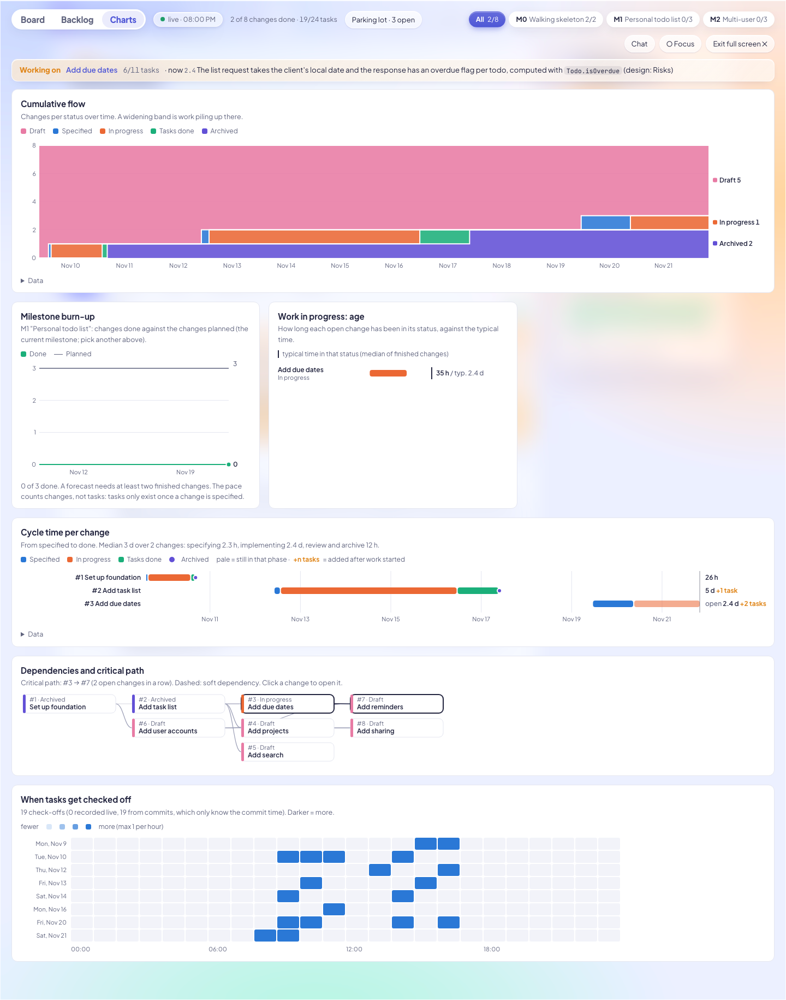

## Talk to the agent (optional)

Start the dashboard with `--agent` to chat with Claude about the project, start a session on a ticket and talk to
it while it works. It runs your local Claude Code (the `claude` command) with its own login; there is no extra key.

```sh
node tools/openspec-dashboard/server.mjs --agent examples/todo-app
```

**Chat** (in the header and on the full-screen board) is a messenger, independent of any ticket. The
**Assistant** reads the project but never changes it, knows its status and remembers the conversation; **New chat**
starts over. Every session started from the dashboard becomes a conversation of its own, and **Terminal session**
sends messages to a session running elsewhere. Enter sends, Shift+Enter starts a new line.

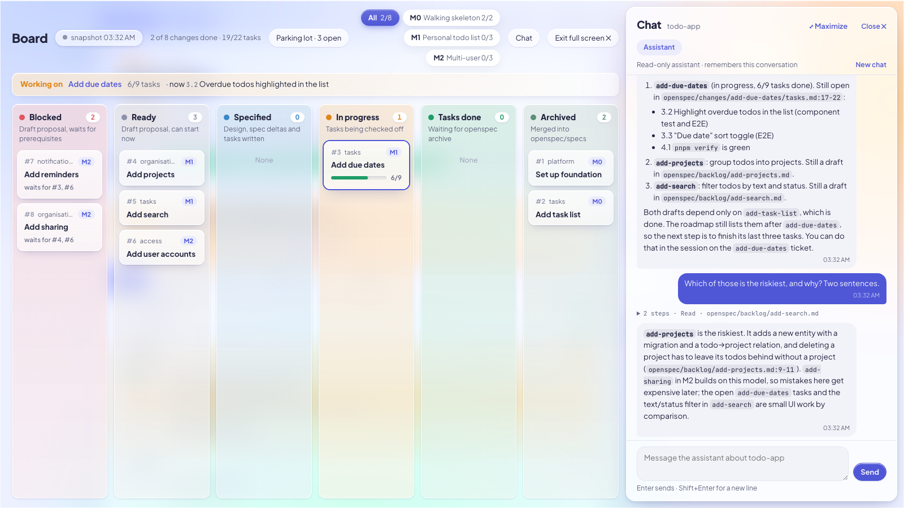

**⤢ Maximize** gives the chat the whole window; `Esc` brings the side panel back.


**Agent…** on a ticket adds the ticket's context automatically: **Ask** a read-only question about it ("Ask about
this task" next to the current task prefills one), or **Start session** to let a new session work on it with the
ticket workflow. The session then shows up in the chat, where you follow its steps, send it messages, end or stop
it, and continue it later.


Before the first session:

- Allow what the workflow needs (the quality gate, `openspec`, `git add`/`git commit`) in the project's
  `.claude/settings.json`: nobody can answer permission prompts in a started session, so they are declined.
- Run `claude` in the project folder once and accept the trust dialog; until then Claude Code ignores the
  project's permission rules (the panel warns about it).
- For a session running in a terminal, install the hook once so it receives messages:
  `node tools/openspec-dashboard/agent-hook.mjs install <project>`.

**Voice input**: if Podman has a speech-to-text image (whisper.cpp's `whisper-cli` with a model), the text boxes get
a microphone. Click it, speak, click **Stop**: the recording is transcribed locally in that container, and the text
lands in the box for you to check before you send it. Pick the language you speak next to it; that is much faster
than **Auto**.

**Rephrase**: with a local language model (an OpenAI-compatible server given with `--rephrase-url`, or a Podman image
with an LLM adapter), **✨ Rephrase** turns a rough draft into a clear prompt: to the point, nothing important
dropped, in the language you wrote. It shows a suggestion; **Accept** replaces your text, **Reject** keeps it. On a
CPU the first request waits until the model has loaded.

Every question, chat message and session is a normal Claude Code run and counts towards your plan. Details:
[dashboard README](../tools/openspec-dashboard/README.md#agent-panel-optional).

## Several projects

Pass several projects, or `--scan` a folder, and the dashboard starts with an overview of all of them:

```sh
node tools/openspec-dashboard/server.mjs --scan=examples
```

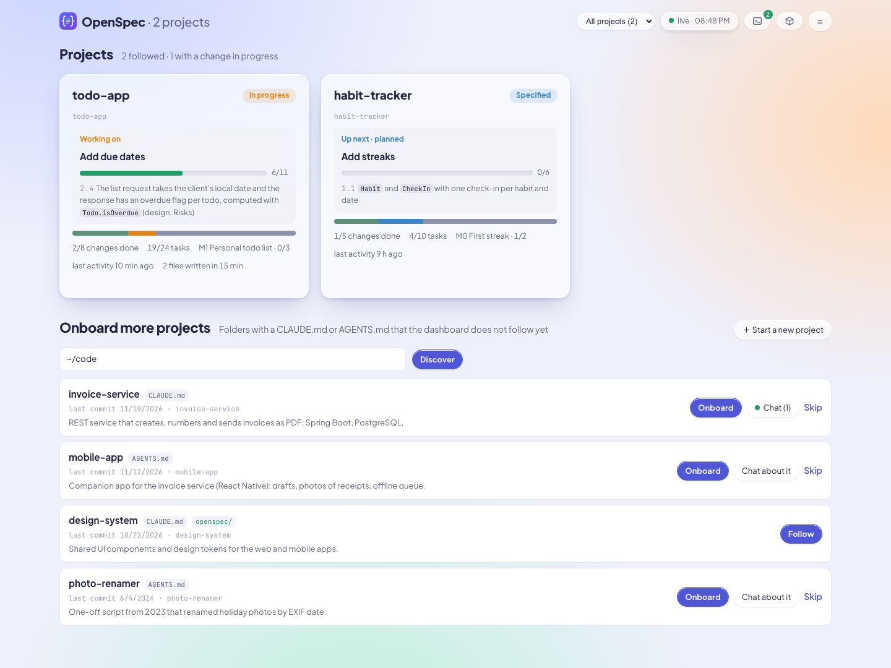

Each card shows the change being worked on and its current task, the task progress, the mix of statuses (the
coloured bar), the current milestone, validation problems and when something last happened; the most recently
active project comes first and the cards update live. Click a card, or pick the project in the header, to open its
dashboard; **All projects** in the picker returns to the overview.

## Styles

The dashboard has ten styles:

| Style | Look |
|---|---|
| **Flat** (default) | clean and quiet |
| **Glass** | frosted panels over a soft colour field |
| **Clay** | warm ivory and terracotta with serif headings, close to the look of Claude; warm charcoal in dark mode |
| **Paper** | post-its on light wooden boards, one colour per column, the current task on a sticky note |
| **Whiteboard** | marker on a framed whiteboard, cards held by magnets; a dark glass board in dark mode |
| **Blackboard** | chalk on a green board in a wooden frame; always dark |
| **Notebook** | squared paper with a red margin line, handwritten headings, quiet cards |
| **Matrix** | falling green code behind glowing panels; always dark; the rain stops with reduced motion |
| **Terminal** | retro green-screen CRT with scanlines and a blinking cursor; always dark |
| **Comic** | halftone dots, thick ink outlines, the current task in a speech bubble |

The style picker in the header switches the style, ◐ switches light and dark; both choices are remembered per
browser. In a link, `?style=<name>` (lower case, e.g. `notebook`) and `?theme=light|dark` set them, e.g.
http://127.0.0.1:4590/?style=paper&theme=dark.

| Flat, light | Flat, dark | Glass, dark |
|---|---|---|
|  | 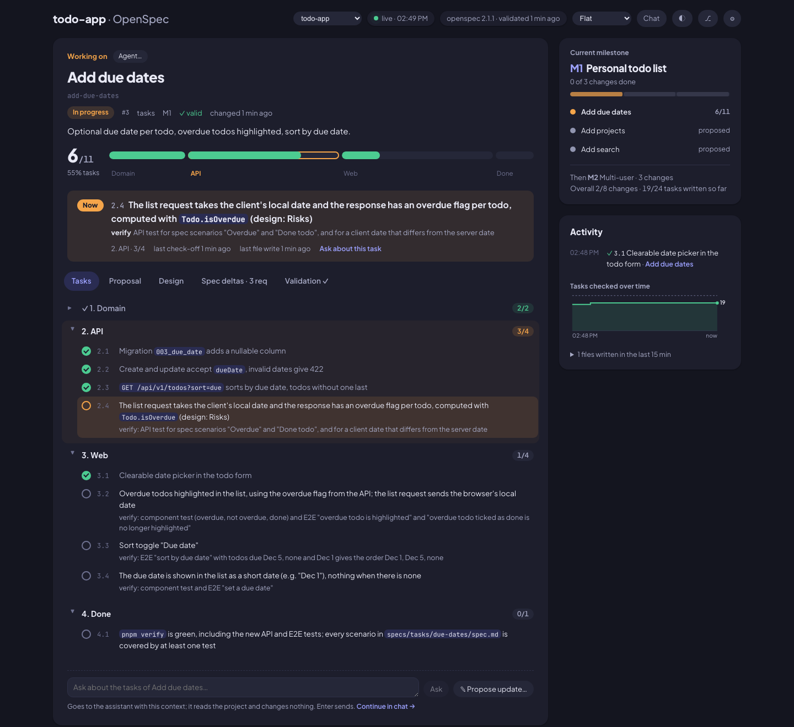 |  |

| Clay, light | Clay, dark |
|---|---|
|  | 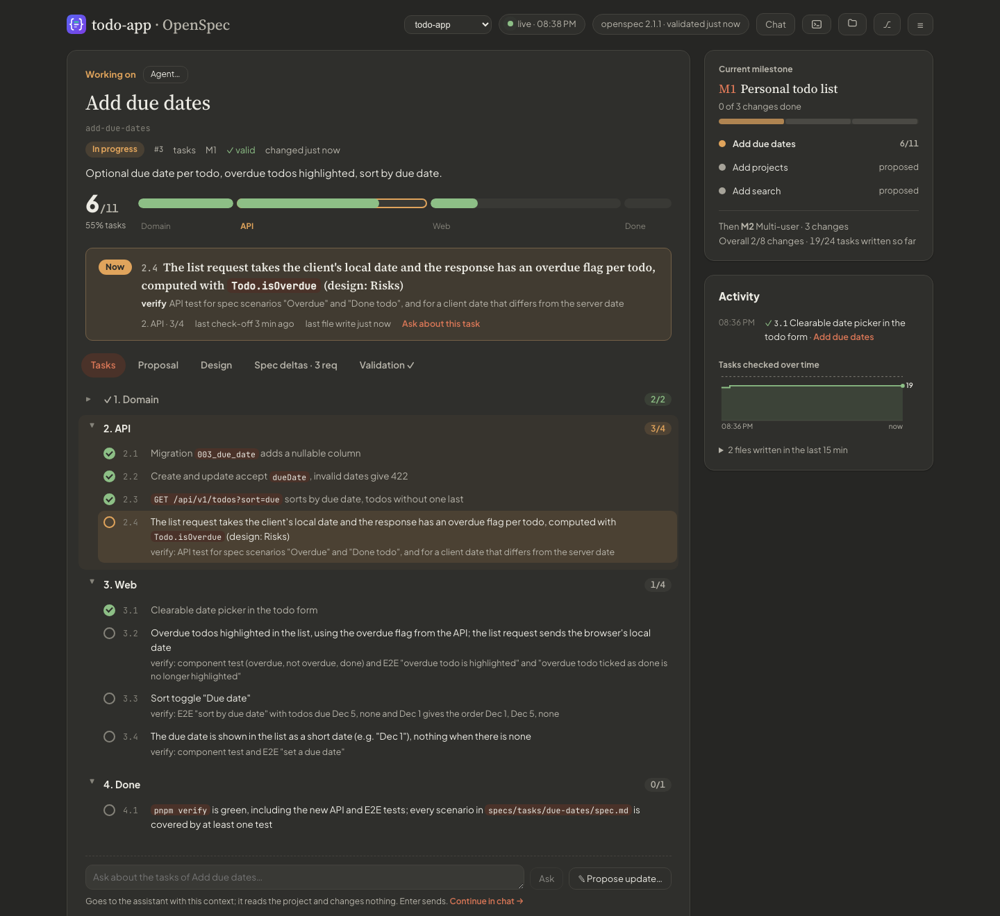 |

| Paper, light | Paper, dark |
|---|---|
| 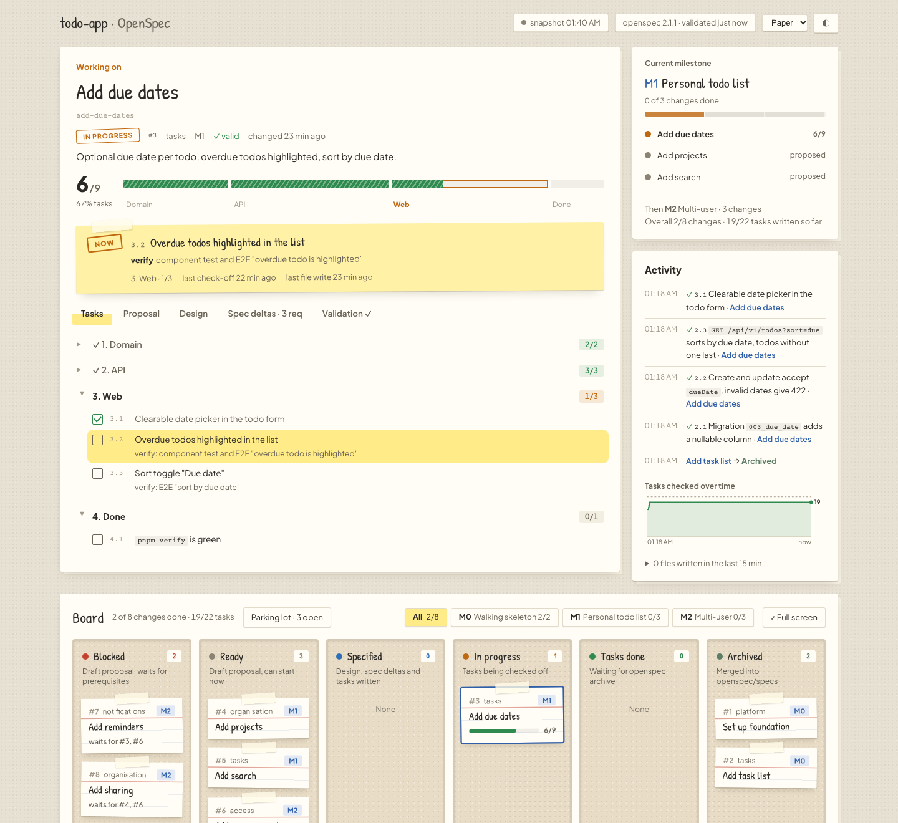 |  |
|  |  |

| Whiteboard, light | Whiteboard, dark |
|---|---|
| 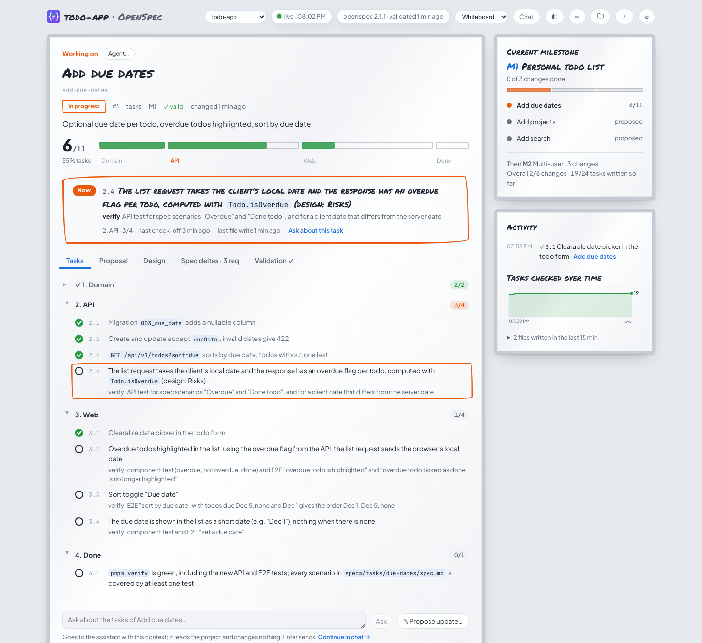 |  |
|  | |

| Blackboard | Blackboard, board in full screen |
|---|---|
| 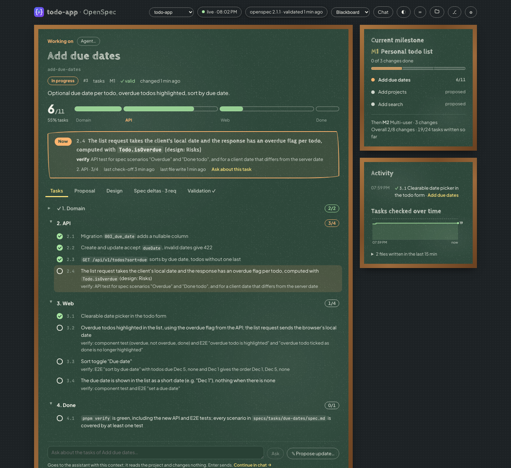 | 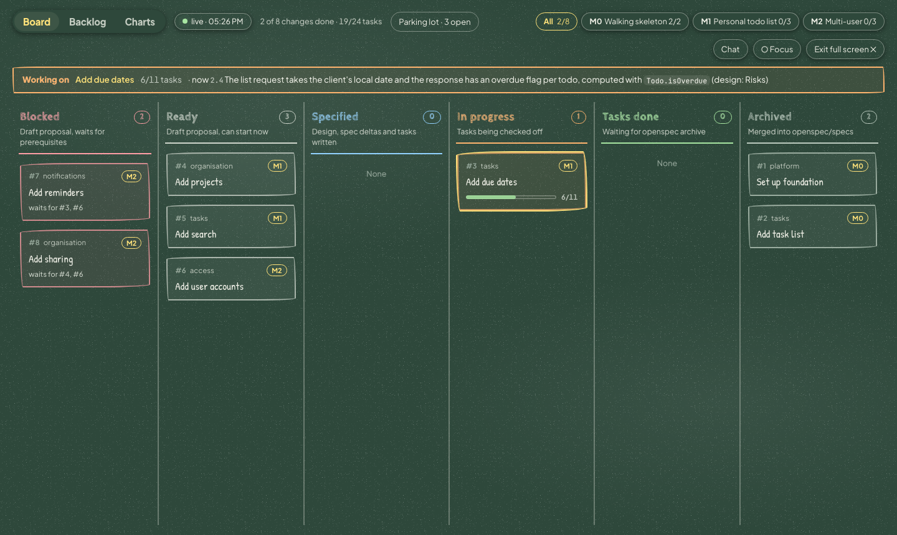 |

| Notebook, light | Notebook, dark |
|---|---|
| 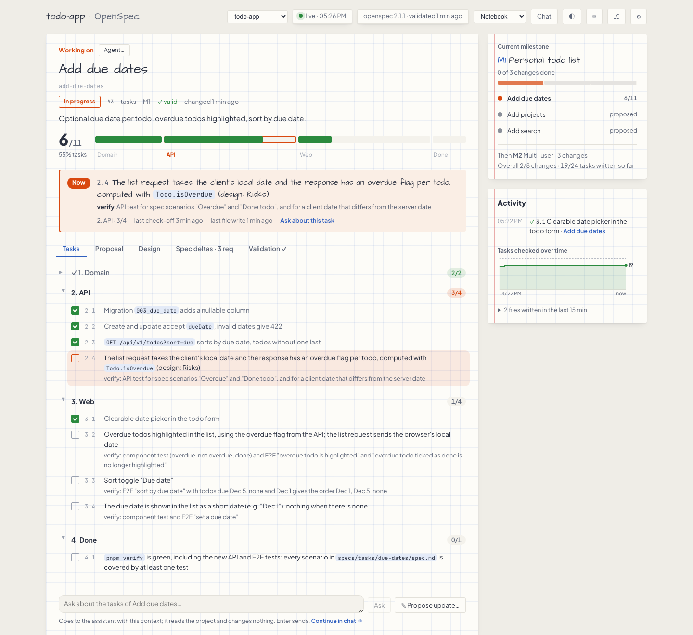 | 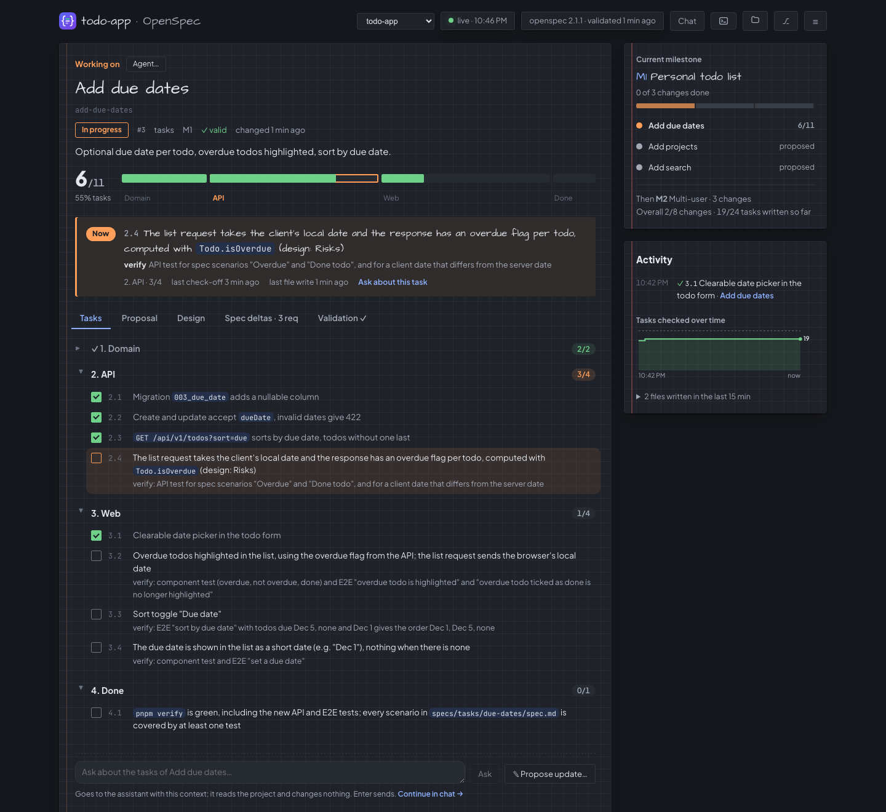 |

| Matrix | Terminal |
|---|---|
| 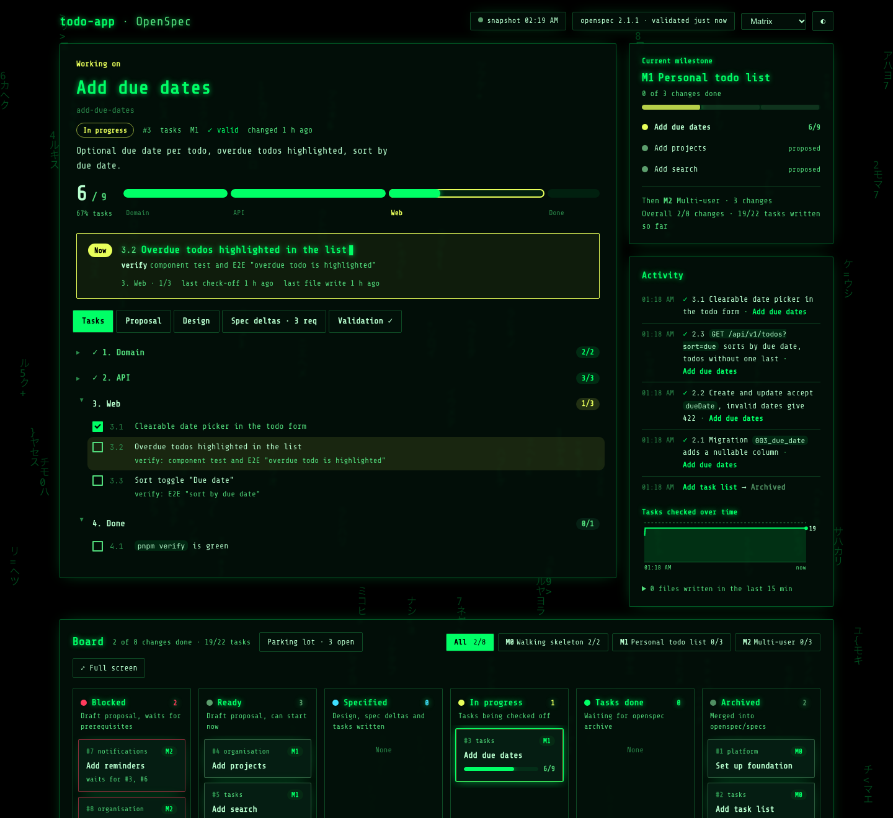 |  |

| Comic, light | Comic, dark |
|---|---|
|  |  |

## Tips

- If OpenSpec runs in a container or behind a wrapper, start the dashboard with `--cli=<wrapper>`.
- The dashboard never writes to your project, except when you reorder the backlog with `--agent`. Its history
  lives in `~/.local/state/openspec-dashboard/`.
- Ticket by ticket, `openspec/specs/` becomes the description of what the system does today; point new team
  members and new agents there first.
- More options: [dashboard README](../tools/openspec-dashboard/README.md). The skill itself:
  [SKILL.md](../skills/openspec-ticket-workflow/SKILL.md).
