# User guide

This guide takes you from the sample to your own project in four steps: look at the sample, set up the workflow,
run tickets with an agent, and follow the progress on the dashboard. You need Node 20+, an agent that reads
skills (e.g. Claude Code) and the [OpenSpec](https://github.com/Fission-AI/OpenSpec) CLI. Rendering the diagrams
also needs podman.

## 1. Look at the sample

[`examples/todo-app`](../examples/todo-app) is the OpenSpec context of a small todo app in the middle of its first
milestone ([`examples/habit-tracker`](../examples/habit-tracker) is a second, smaller one). It has no code, only
`openspec/`:

| Path | What it shows |
|---|---|
| `openspec/config.yaml` | project context, the rules for proposals, specs and tasks, and the ticket workflow as agent guidance |
| `openspec/roadmap.md` | eight changes in order, with prerequisites and three milestones |
| `openspec/backlog/` | drafts of the five changes that have not started |
| `openspec/changes/add-due-dates/` | the ticket in progress: proposal, design, spec deltas, tasks with `verify:` criteria, 6 of 11 done |
| `openspec/changes/archive/` | two finished tickets, archived in the commit that completed them |
| `openspec/specs/` | the living specs those two tickets produced |
| `openspec/changes/parking-lot/` | deferred review minors, known issues and trade-offs |

Start the dashboard on it:

```sh
cd examples/todo-app
node ../../tools/openspec-dashboard/server.mjs
```

It opens http://127.0.0.1:4590/. With `openspec` on your `PATH` it also shows the validation result per change;
without it, add `--no-cli`.

## 2. Set up your project

Copy the skill into your project and let the agent set the workflow up:

```sh
cp -r skills/openspec-ticket-workflow <your project>/.claude/skills/
```

Then ask the agent, in your project:

> Set up the OpenSpec ticket workflow. The quality gate is `pnpm verify`.

The agent merges the workflow into `openspec/config.yaml`, creates `openspec/roadmap.md`, a draft per planned
change in `openspec/backlog/` and the parking-lot change, and adds one line to your agent instructions. Write or
review the roadmap yourself: its order and the *Depends on* column decide what can start when.

## 3. Run tickets

Ask for the next ticket, or name one:

> Run the next ticket.
> Run `add-due-dates`.

The agent works through the ten steps of the [workflow](../README.md#the-workflow): it elaborates the change, implements it
with tests, runs the quality gate, has fresh agents check acceptance, review the diff and validate the findings,
fixes what is worth fixing, updates the docs, runs the gate again, then archives the change and makes one commit.
At the end it reports the result and the next ticket the roadmap allows.

You stay in control of three things:

- **The roadmap**: order, prerequisites, milestones. Candidates found during tickets are added there for you to plan.
- **Deviations**: when the acceptance check finds that the built behaviour differs from a scenario, the agent
  either fixes it or records it in the spec; read those spec updates.
- **The parking lot**: triage it at every milestone and promote items to real changes.

## 4. Follow the progress

Start the dashboard in your project (`node <path-to>/tools/openspec-dashboard/server.mjs`) and keep it open while
the agent works. It updates within a second of every file change. The screenshots show the **Glass** style; see
[Styles](#styles) for the others.


**As an app.** `launcher.mjs` installs a launcher with the dashboard's logo: on macOS an app in `~/Applications`
(Launchpad, Spotlight, and in the Dock if you drag it there), on Linux an entry in the application menu. A click
starts the dashboard if it is not running yet and opens it in a window of its own, like an app (Chrome, Edge, Brave
or Chromium in app mode: no tabs, no address bar); the options after `--` are the dashboard's:

```sh
node <path-to>/tools/openspec-dashboard/launcher.mjs install -- --agent --scan=~/code
```

`--port=` picks the port (4590 by default), `--name=` the app's name, `--tab` opens the dashboard in a tab of the
default browser instead (also what happens when none of those browsers is installed).

**With its own icon in the Dock.** The page can be installed as a web app: open it in Chrome (or Edge, Brave) and
click **Install** in the address bar (Safari: File › Add to Dock). It then runs in its own window with the logo in
the Dock, where it can stay (right click › Options › Keep in Dock); the launcher opens it from then on. A web app
cannot start the dashboard by itself, so install the launcher with `--service`: the dashboard then runs from login
on (macOS: a LaunchAgent, restarted if it ends; Linux: a systemd user service), and the pinned icon always finds
it. `launcher.mjs uninstall` removes the service as well.
 `launcher.mjs stop` ends a dashboard the
launcher started, `launcher.mjs uninstall` removes the launcher.

- **Working on** shows the change in progress and the **current task**, the first unchecked one, with its
  `verify:` criterion. Below it: when the last task was checked off and when a project file was last written, so
  you can tell whether the agent is still busy.
- The progress bar has one segment per task group; the group with the current task is outlined.
- The tabs show the proposal, design, spec deltas and the `openspec validate` result of the change (see
  [Validation](#validation) below). With `--agent`, every tab has a question box below its content: the question
  goes to the assistant with that context (e.g. "the design of add-due-dates" and its file), and the answer shows
  right there (**Ask** works once there is a question); **Continue in chat** opens the whole conversation.

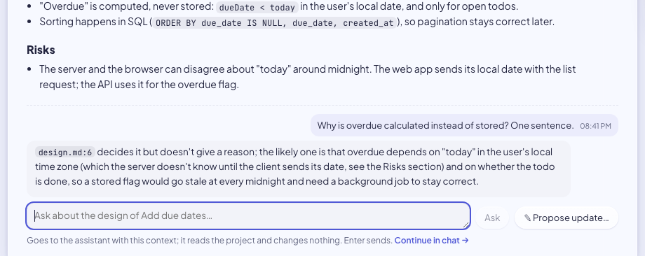

  When something should change, **✎ Propose update…** (next to Ask) opens a dialog for that tab: it shows the change,
  the file and its current content, and asks what should change (suggestions fill it in, e.g. "Split tasks that
  are too big"; if you discussed the tab below it, that can be taken into account). **Propose** asks Claude for an
  updated version of the file.


  The proposal shows as a diff (removed lines red, added lines green, unchanged ones folded), in the dialog and
  below the tab; **Accept** writes the file, **Reject** leaves it as it is. Claude itself never writes: only Accept
  does, and only if the file has not changed since the preview (otherwise you get a new preview). This also works
  in the chat, when you ask Claude there to change a file.

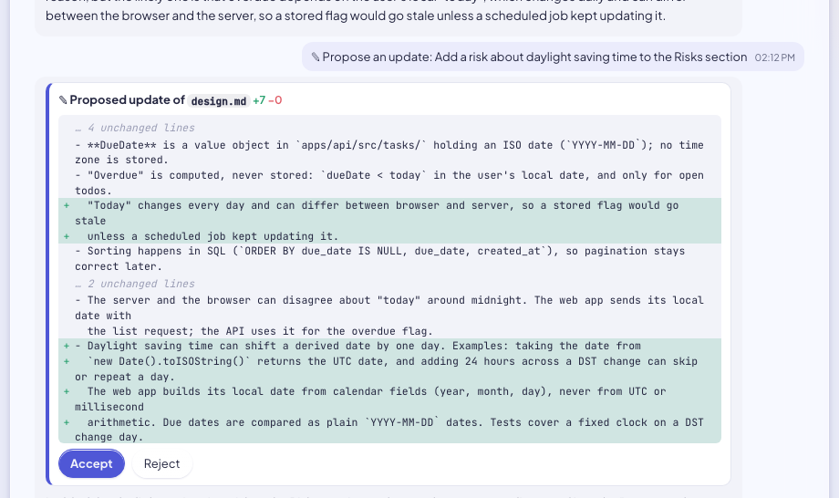
- **Current milestone** lists the other changes of the milestone; **Activity** lists every checked-off task and
  status change since the dashboard started, with a chart of tasks done over time.
- The **Board** shows every change in the column its files put it in. "Waits for #3, #6" names the unfinished
  prerequisites. The parking lot is the chip next to the counts.

### Validation

The **Validation** tab shows what `openspec validate` says about the change, and what it checked. It matters from
the moment a change is specified (design, spec deltas and tasks written) until it is archived: a draft in
`openspec/backlog/` is not an OpenSpec change yet, and an archived change is part of `openspec/specs/`, so the tab
says that instead of a result.

For a change that passes, the tab lists every spec delta the CLI checked: the operation (ADDED, MODIFIED, REMOVED),
the capability, the requirement and how many scenarios it has.

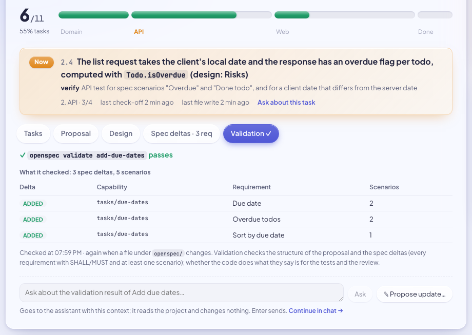

When it fails, errors come first, then warnings and notes, each with the spec file it is about; a requirement
without a scenario shows a red **0** in the table. The tab is labelled **Validation · 2** (the number of issues),
and the change's card on the board says "✕ validation fails", so a broken spec delta is visible without opening
it.


Validation checks the structure: a proposal, requirements written with SHALL or MUST, at least one scenario per
requirement. Whether the code does what the scenarios say is for the tests and the review. The dashboard runs the
CLI again whenever a file under `openspec/` changes, and the tab says when it last checked, or what the CLI is busy
with.

### Board

**⤢ Full screen** shows only the board, still live, with the current change and task in a line at the top:


Click a card to open its details next to the board; `Esc` closes them. A link to a card's details is
`#board:<change>`, e.g. http://127.0.0.1:4590/#board:add-due-dates:

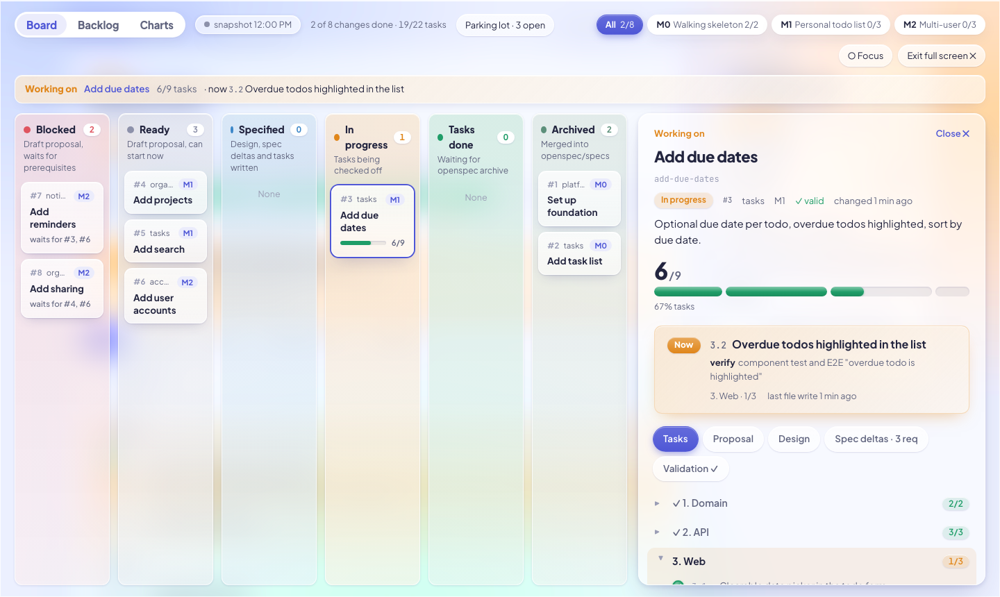

**○ Focus** hides the archived changes and folds empty columns into narrow strips, so the open work gets the space
(`?focus` in a link):


**Backlog** shows the roadmap as a list per milestone, like the backlog of an issue tracker. The change you opened
last stays highlighted, so you find your place in the list again. With `--agent` you can reorder the changes that
have not started: drag one by its handle (⠿) within its milestone, or use Alt+↑/↓. The dashboard rewrites
`openspec/roadmap.md`, keeps the numbers of the positions and updates every *Depends on* reference; it refuses a
move that would put a change before one of its prerequisites.

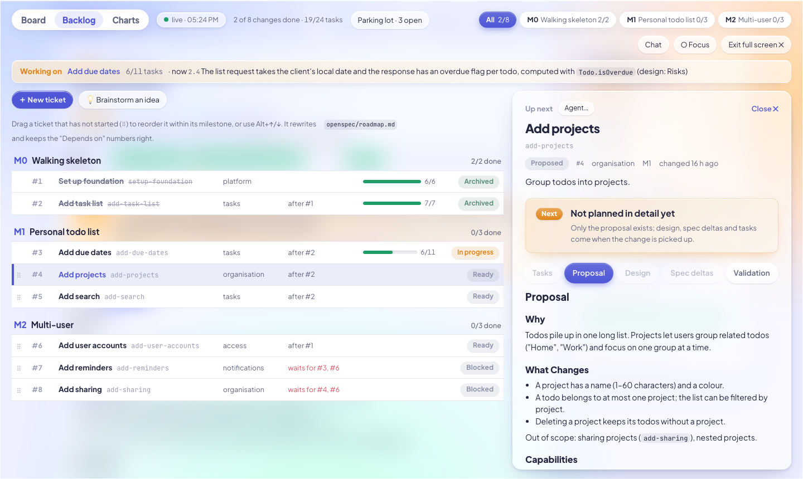

With `--agent` the backlog also takes new work. **＋ New ticket** opens a form for the draft and its roadmap entry:
**Add to roadmap** plans it at the end of the chosen milestone, ready to start; **Save as idea** keeps it as a draft
that still needs refinement, listed under **Ideas** at the end of the backlog and nowhere else.

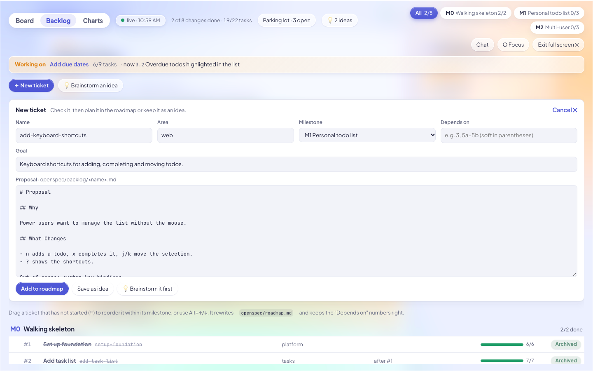

**💡 Brainstorm an idea** (or **Refine** on an idea) starts a brainstorming conversation in the chat. Claude asks
questions, checks the roadmap and the specs for overlaps and prerequisites, and keeps the ticket small; when you
agree, it writes the ticket as a card. **Review and save…** opens it in the form, where you plan it or keep it as an
idea. If the brainstorming does not lead anywhere, nothing is saved.

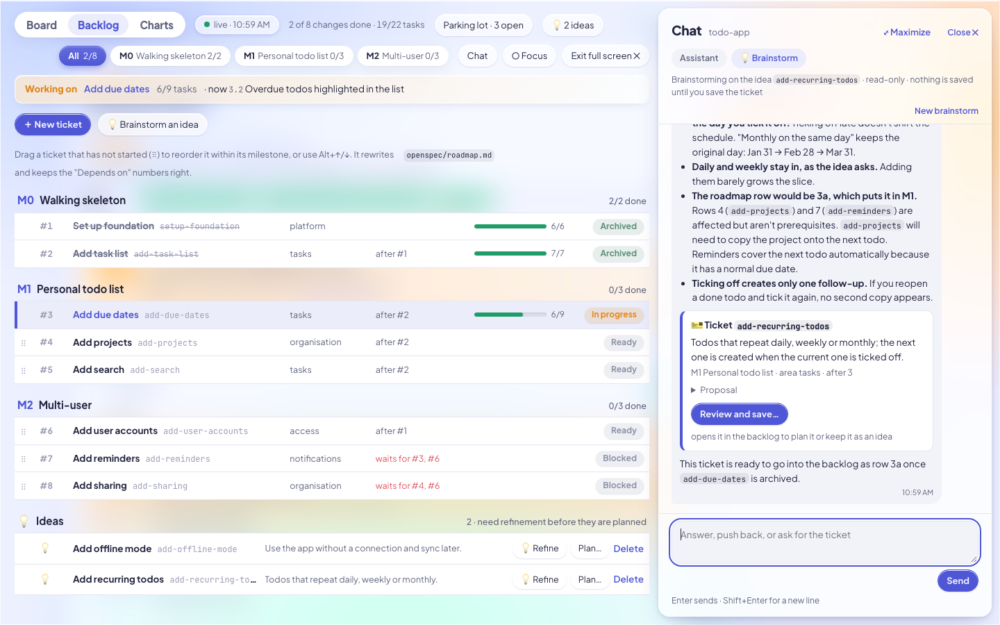

**Charts** shows how the work flows: a cumulative flow diagram, a burn-up of the milestone with a forecast, the
age of open changes against the typical time, the cycle time of each change split into its phases, the
dependency graph with the critical path, and when tasks get checked off. The milestone picked above filters them.
They are built from the git history of `openspec/` and from what the dashboard recorded while it ran, so they also
cover the time before you first started it; hover for values, **Data** shows a table. **○ Focus** shows open work
only: no archived band in the flow, no archived changes in the cycle times and the dependency graph.


### Git history

**⎇** in the header (on a project's page, in a git repository) opens the history of the project's repository; an
orange dot on it says there are uncommitted changes (the tooltip counts the files changed, added or deleted):

- at the top the commits, newest first, with a graph of the branches and badges for the current branch, other
  branches, tags and remote branches; more load as you scroll;
- below the selected commit: who made it and when, its message, its parents, the files it changed and their diff
  (a merge against its first parent).

Click a commit or move with ↑ ↓ (or j k), Page Up, Page Down, Home and End. Click the commit id to copy it, a parent
to jump to it, a file to scroll to its diff. **openspec/ only** shows only the commits that changed the specs.
**⤢ Maximize** puts the commits and the details side by side; `Esc` restores, then closes. A new commit shows up on
its own. It only reads: nothing in the repository changes.

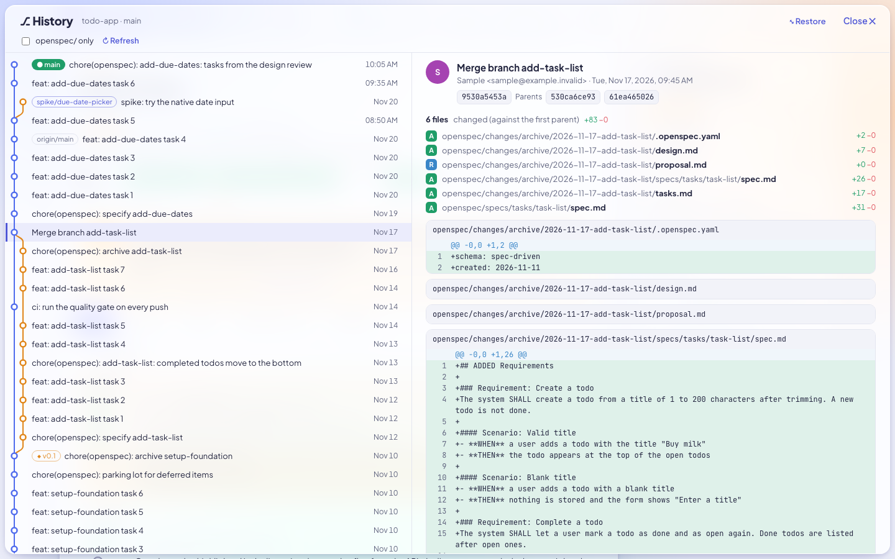

### Open the project folder

The folder button in the header (with `--agent`, on a project's page) opens the project's folder in a file manager.
Which one is set in **⚙ Settings › General** under **Open project folders with**: empty for the system's file manager
(Finder, Explorer, `xdg-open`); on macOS the name of an app, which opens the folder with `open -a <app>`; or a command
with `{dir}` for the folder, e.g. `my-file-manager --path {dir}`. The command runs without a shell, and the setting is
kept in the dashboard's settings file, not in the project. The file manager has to accept a folder to open, as a
start argument or (on macOS) as a document to open; one that ignores it only starts.

## Talk to the agent (optional)

Start the dashboard with `--agent` to chat with Claude about the project, start a session on a ticket and talk to
it while it works. It runs your local Claude Code (the `claude` command) with its own login; there is no extra key.

```sh
node tools/openspec-dashboard/server.mjs --agent examples/todo-app
```

**Chat** (in the header and on the full-screen board) is a messenger, independent of any ticket. The
**Assistant** reads the project but never changes it, knows its status and remembers the conversation; **New chat**
starts over. Every session started from the dashboard becomes a conversation of its own. Sessions running in a
terminal have a panel of their own, behind the terminal button (see below). Enter sends, Shift+Enter starts a new line.


**⤢ Maximize** gives the chat the whole window; `Esc` brings the side panel back.

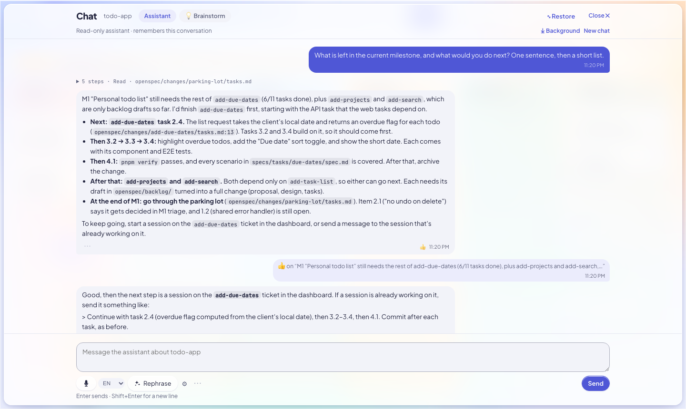

**Quick replies.** Each of Claude's answers has a faint **⋯** next to its time. Move the mouse over the answer (or
tap ⋯) and a row of buttons appears:

- 👍 ✅ 🌿 🙏 🎉 💡 react at once, each with a short sentence ("I agree with this.", "Yes, go ahead with this.",
  "Thanks, that helps.", "Great, that is exactly right.", "Good idea, let us keep that."); only positive ones. 🌿
  accepts a proposal but has it done on a new git branch: Claude creates one named after it, works there and leaves
  merging to you;
- 🔁 asks for the answer again in simpler words, 📝 for a summary in a few bullet points, 📊 for an overview table,
  and 🔄 has it tried again (e.g. a failed run, after you changed something);
- ↩ quotes the answer in your next message; select a part of it first to quote just that part.

**⋯ under the input box** opens quick messages that are not about one answer but sent with one click as they are.
They are handy while a session works: the message reaches it mid-turn, and it answers before it continues. The
thread shows each one short, e.g. **👀 Status**.

- find out where it stands: 👀 the current status (done, now, next), ❓ whether anything blocks it or it needs a
  decision, 🔍 a summary of the changes so far (files and why, nothing committed), 📍 which task of the current
  change it is on and how many are left;
- steer the work: ⏸ finish the current step, then stop and wait, 🎯 stay within the current ticket and put anything
  else in the parking lot, 🧹 wrap up (finish the task, update tasks.md, summarize);
- quality: 🧪 run the quality gate now and report the result, without fixing anything yet.

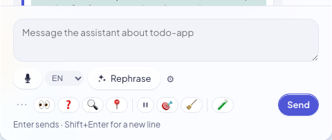

Claude gets the answer's first sentence (or the part you selected) as the reference, so it knows which answer you
mean even when the conversation has moved on, without the whole answer being sent again. Reactions show as small
badges on the answer, quotes as a quote above your text.

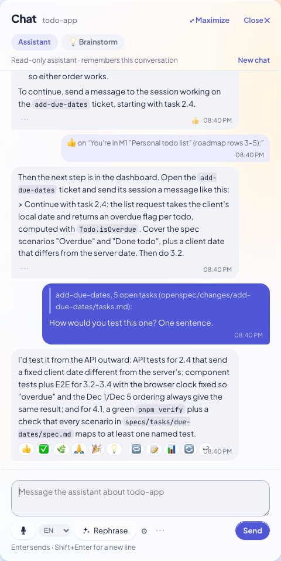

**Agent…** on a ticket adds the ticket's context automatically: **Ask** a read-only question about it ("Ask about
this task" next to the current task prefills one), or **Start session** to let a new session work on it with the
ticket workflow. The session then shows up in the chat, where you follow its steps, send it messages, end or stop
it, and continue it later.

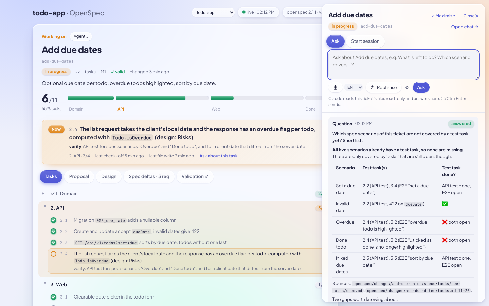

Before the first session:

- Allow what the workflow needs (the quality gate, `openspec`, `git add`/`git commit`) in the project's
  `.claude/settings.json`: nobody can answer permission prompts in a started session, so they are declined.
- Run `claude` in the project folder once and accept the trust dialog; until then Claude Code ignores the
  project's permission rules (the panel warns about it).
- Sessions running in macOS Terminal need nothing else (see below); for one in an IDE or another terminal app, set
  up the hook once.

### Join a session running in a terminal

The terminal button in the header (a terminal window with a prompt, `>_`) opens **Terminal sessions**; its badge
counts the running sessions. The drop-down
lists the Claude Code sessions of the project (in a terminal or an IDE), the latest on top, with the last prompt you typed there,
whether it is working or waiting for input, and when it last did something; ended ones stay in the list for 12
hours. Pick one to join it: you see what it does, live (your prompts, Claude's replies and its steps). The end of
the thread says where it stands: **Working: <its current step> · since <time>** while it works (an answer is on its
way), **✓ Done · waiting for your next message** once it has answered, or **Session ended**. Following a session
needs no setup: the dashboard finds the running sessions in Claude Code's own records (`~/.claude/sessions`) and
reads their transcripts.

The drop-down also lists sessions running in other folders. One in another project the dashboard follows is under
**Other projects**: picking it switches to that project and joins the session there. One in a folder the dashboard
does not follow is under **Session only**: you follow it without a board, roadmap or specs around it, and
**Onboard it as a project…** opens the onboarding chat for its folder in the overview (or **Follow it as a
project** when the folder has an `openspec/` already). On the overview, the terminal button lists every running session the same
way.

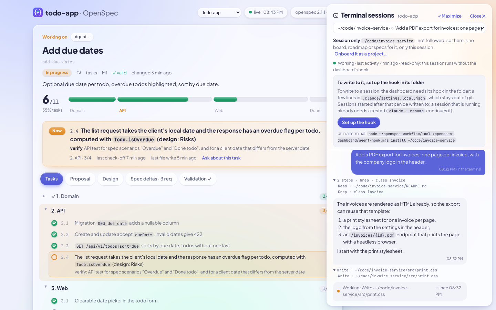

**Write to it.** A joined session is read-only at first; **✎ Write to it** next to its state starts writing. Your
message is typed into the session's macOS Terminal tab and sent with
Return, exactly as if you typed it there, also while the session waits at its prompt; no setup is needed, and the
transcript marks it as *typed from the dashboard*. It goes as one line (line breaks become spaces). The dashboard
only types while Claude Code itself is in the foreground of that tab (never into a shell), and not while the session
asks you something there (a permission, a choice), since Return would answer it. Terminal may ask once whether the
dashboard may control it.

While you write, the details above the conversation fold into one line (**✎ Writing to …**, its state, **Details ▾**,
**Read only**), so the conversation gets the panel. That way a session you started in the terminal continues in the
dashboard. If its folder is not a project of the dashboard yet, **Onboard as project** next to **Read only** sets up
OpenSpec there right away (after one confirmation; in the background, nothing committed; the session keeps
running) and shows the progress on the overview, and **Follow now** follows a folder that has an `openspec/`
already and continues the session there. **Details ▾** shows the session picker and the notes again,
**Fewer details ▴** folds them. Claude's answers have the same quick replies as the chat (👍 ✅ 🌿 🙏 🎉 💡, 🔁 📝 📊 🔄
and ↩ to quote, also a selected part); they are typed into the session like any message, and the thread shows them
as reactions and quotes.

**Send it to the background.** For a longer task, **⤓ Background** (next to **Read only**) closes the panel and
keeps the session in a list; a button with the number of sessions appears in the header, on every page of the
dashboard. Its dot is amber while one still works, green when all are done, red when one needs you or has an issue;
**n ✓** counts the ones that finished since you last looked. A click opens the list, with a status per session:

- pulsing amber: still working;
- **✓** green: done, waiting for your next message (with the start of its last reply);
- **?** orange: it needs you, it asks something in its terminal (a permission, a choice);
- **!** red: an issue, the session has ended or its last reply is an error.

A click on an entry opens the session in write mode (on its project's page), ✕ removes it from the list (the
session keeps running), **Clear finished** removes the done ones. The list is kept in the browser. The joined
session's thread also says **Needs you** while it waits for an answer.

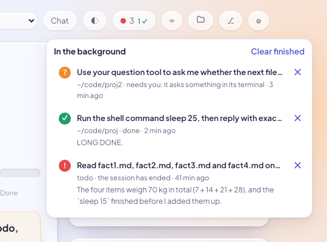

**The look while writing.** **▣ Terminal** shows the conversation in terminal colors (dark, monospaced; your own
messages keep a bright blue background, so they stand out), with the steps as the CLI shows them
(`⏺ Bash(git log --oneline -3)`, then `⎿` and the first lines of the result); a second click colors the whole panel,
including the input area, and a third brings the normal colors back. **A−** / **A+** change the text size, **A**
resets it. The CLI's own rendering of some tools (e.g. the colored diff of an edit) and live output while a command
runs are not shown.

**Falling code while you wait.** When an answer takes longer than 30 seconds, green code rains behind the
conversation, as in the Matrix style, until the session is done: the moment it stops, the answer is in, so you see
at a glance whether it has finished, even from across the room. It shows in both color modes and only while you
write to a session (with reduced motion it is a still image).

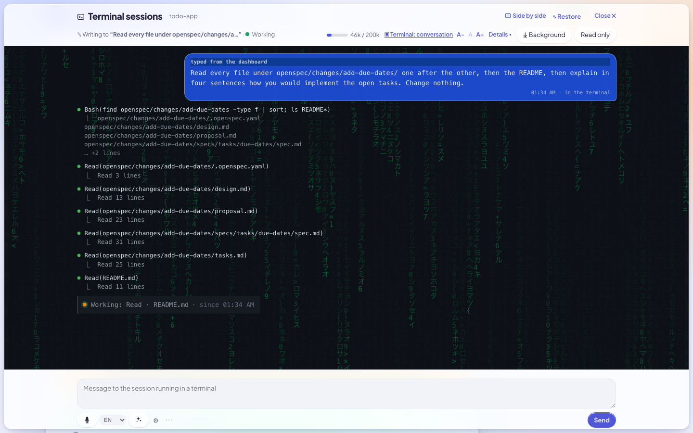

**⚙** below the input box opens the settings on the **Write mode** tab while you write to a session: turn the
falling code off, or start it after another number of seconds (5 to 600; 30 by default), and choose the color of
**your messages**: highlighted (the default: bright blue in terminal colors, the style's color otherwise), the color
of the current style (in terminal colors too), or a color of your own (the text turns dark or light to stay
readable). All of the look settings are remembered in the browser.

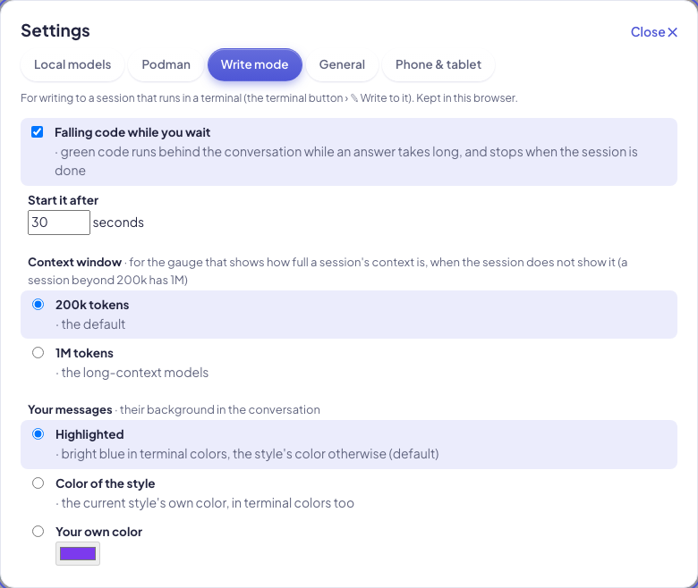

**Sessions elsewhere: the hook.** For a session the dashboard cannot type into (in an IDE, another terminal app or
not on macOS), the panel offers **Set up the hook**: a few lines in the project's `.claude/settings.local.json`,
kept out of git through `.git/info/exclude` (or run `node tools/openspec-dashboard/agent-hook.mjs install
<project>`); it also works for a session-only folder. Sessions started after that can be written to; one that runs
already is marked **◌ … read-only** until you restart it (`/exit`, then `claude --resume <id>` continues it). With
the hook, your message reaches the session at its next step; a session that waits for input takes it with the next
prompt typed there (the message says so while it is queued). **👂 Keep it listening** changes that from the
session's next answer on: when it is done, it waits for your message instead of stopping (the terminal shows the
hook running; `Esc` there takes it back), and each of your messages continues it; **👂 Listening · stop** lets it
finish. **Any session** sends to whichever session takes the next step.

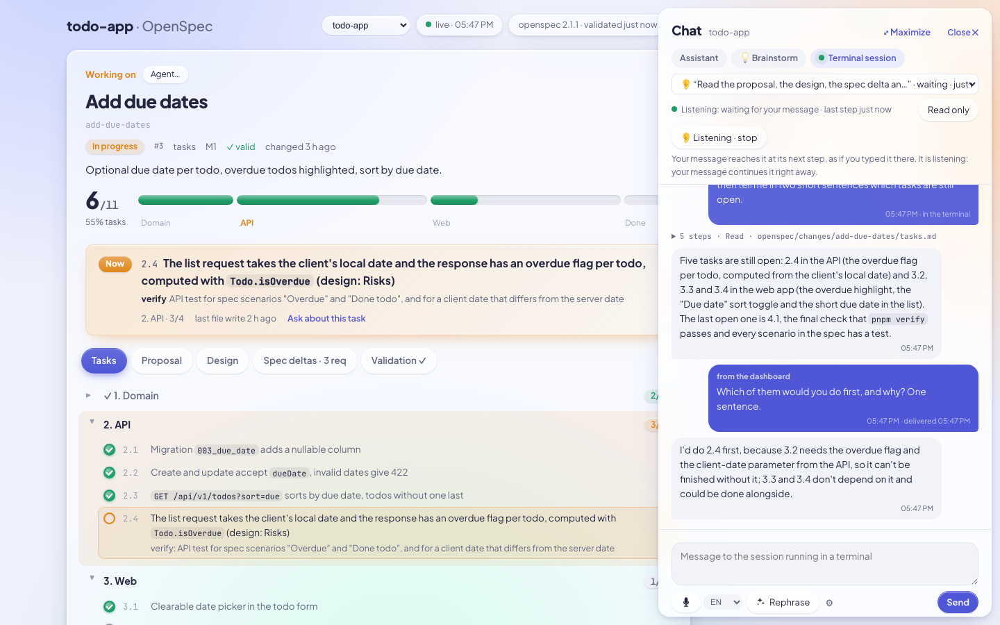

### Voice input, rephrasing and the local models

**Voice input**: if Podman has a speech-to-text image (whisper.cpp's `whisper-cli` with a model), the text boxes get
a microphone. Click it, speak, click **Stop**: the recording is transcribed locally in that container, and the text
lands in the box for you to check before you send it. Pick the language you speak next to it; that is much faster
than **Auto**.

**Rephrase**: with a local language model (an OpenAI-compatible server given with `--rephrase-url`, or a Podman image
with an LLM adapter), **✨ Rephrase** turns a rough draft into a clear prompt: to the point, nothing important
dropped, in the language you wrote. It shows a suggestion; **Accept** replaces your text, **Reject** keeps it. On a
CPU the first request waits until the model has loaded.

**⚙ Settings** (in the header's ☰ menu, and next to Rephrase) shows the models in use, with the matching option and its image
and model filled in. With **Choose automatically** the dashboard picks them; untick it to keep that setup fixed or to
choose: for Rephrase a container with its image and model, a local server such as Ollama or LM Studio (URL and model name),
Apple's on-device model on macOS 26 with Apple Intelligence, or off; for speech-to-text the whisper image, or off.
**Test** tries the setting with a sample sentence, **Load now** starts a container model before you need it.

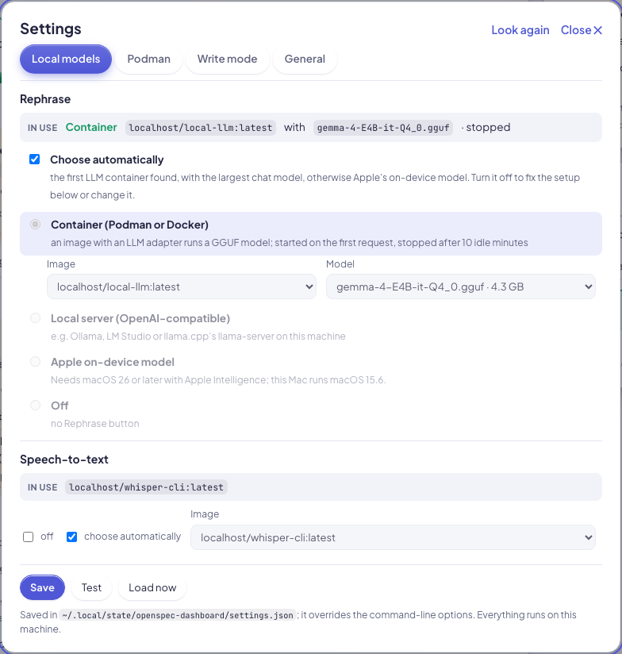

The **Write mode** tab holds the settings for writing to a session, **General** the file manager for the folder
button (see above). The **Podman** tab of the same dialog shows how the Podman VM is doing (memory, CPU load, disk) and its containers:
the 15 used last at the top (running ones first), then all others by name, each with a **Start** or **Stop**
button. When the VM is stuck or full, **Restart the VM** stops and starts it; the containers you checked (↻) come
back, the others stay stopped. The dashboard's own model container cannot be checked: it is removed when it stops
and started again on the next request.


Every question, chat message and session is a normal Claude Code run and counts towards your plan. Details:
[dashboard README](../tools/openspec-dashboard/README.md#agent-panel-optional).

## Several projects

Pass several projects, or `--scan` a folder, and the dashboard starts with an overview of all of them:

```sh
node tools/openspec-dashboard/server.mjs --scan=examples            # add --agent for onboarding (below)
```


Each card shows the change being worked on and its current task, the task progress, the mix of statuses (the
coloured bar), the current milestone, validation problems and when something last happened; the most recently
active project comes first and the cards update live. Click a card, or pick the project in the header, to open its
dashboard; **All projects** in the picker returns to the overview. Projects with the same folder name are told apart
by the end of their path, e.g. `examples/todo-app` and `acme/todo-app`, on the cards, in the picker and in the title,
and so are the folders in the list of projects to onboard below.

### Archive and unfollow

Every project the dashboard follows costs a little all the time: it watches `openspec/`, looks at the files of the
whole project to tell when something was last written, and validates the changes with the OpenSpec CLI (in a
container, if you use one) whenever `openspec/` changes. So with `--agent`, each card has two links at the bottom
(they show when you point at the card):

- **Archive**: for a project that is done or on hold. The dashboard stops watching, scanning and validating it; it
  moves to a folded **Archived** section below the projects, with the status it had. **Reactivate** follows it again.
- **Unfollow**: the dashboard stops following it and lists it below only by name; **Follow again** brings it back,
  **Archive** moves it to the archived ones (without the status, since it was not watched any more), ✕ removes it
  from the list.

Neither changes anything in the project, and both are remembered, also for projects given on the command line. The
dashboard keeps following at least one project, and a project Claude is working in (a session or an onboarding)
can only be put aside once that has ended.

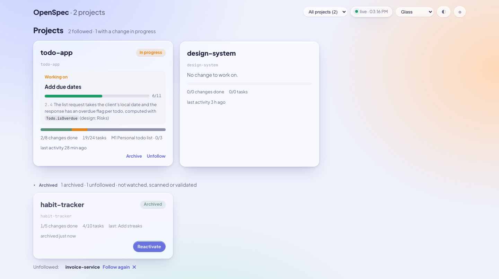

To keep large projects cheap, the dashboard looks at a project's files every 10 seconds only while someone has it
open, and every 2 minutes otherwise (the "files written" figure on a card can be up to 2 minutes old); a project
that takes long to look at is looked at less often.

### Onboard more projects

With `--agent`, the overview also finds projects to onboard (the lower half of the screenshot above). Enter a folder
under **Onboard more projects** and press **Discover**: it lists the folders below it with a `CLAUDE.md` or
`AGENTS.md` that the dashboard does not follow yet, with the first line of their README and their last commit. A
folder that has `openspec/` already gets **Follow**.

**Onboard** lets Claude set up OpenSpec and the ticket workflow in that project in the background (nothing is
committed; check the result in git), and adds the project to the dashboard when it is done. Not sure? **Chat about
it** first: Claude looks at the project read-only and recommends onboarding it or not. Then press **Onboard it**,
or **Skip → next candidate** to move on to the next one.

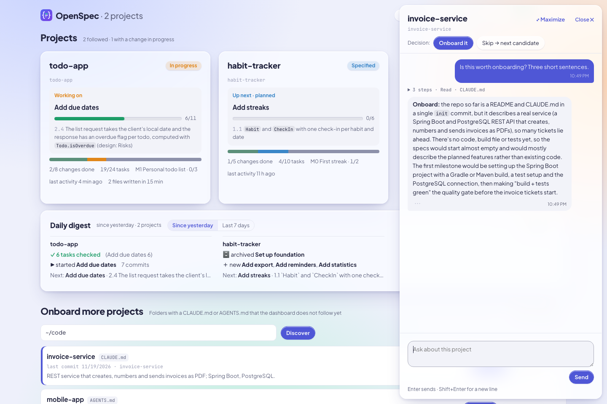

While it runs, the row says what Claude is doing right now; **Show progress** opens the whole picture: Claude's plan
(it writes one first and keeps it current) with what is done ✓, what it is doing now ◐ and what is still open ○, a
progress bar, how long it has been running, and every step so far, newest at the bottom, updating live. Once the
project is followed, **What it did** shows the same with Claude's summary. A new project (below) shows the same
progress while it is set up.

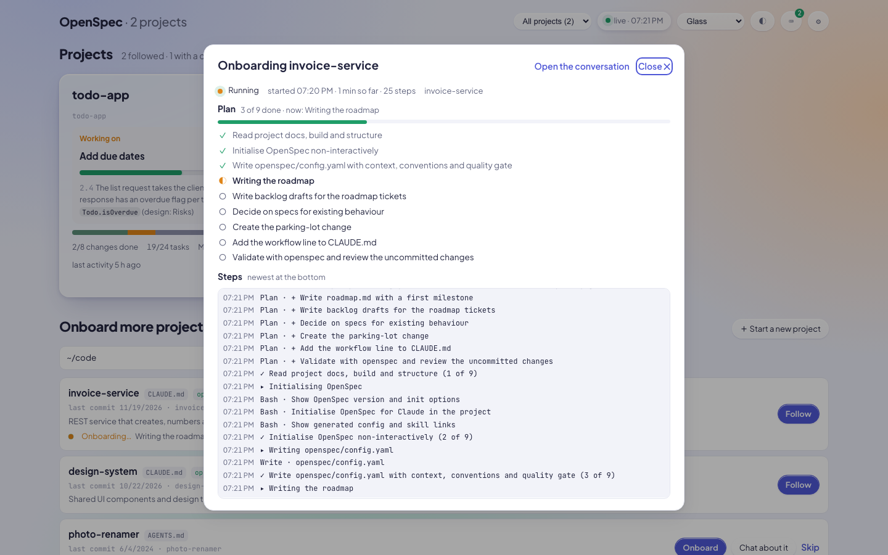

### Start a new project

**＋ Start a new project** (on the right of the "Onboard more projects" heading in the screenshot above) brainstorms a
project that does not exist yet. It opens full screen; **⤡ Restore** (or `Esc`) shrinks it to a side panel, and the
choice is remembered. Choose the folder it
goes into and describe the idea; Claude asks about the problem, the users, the scope of a first version, the stack
and the quality gate, and proposes a first milestone of tickets. Once you agree it shows the project as a card.
**Create project…** asks for the folder name; **Create and set up** creates the folder and lets Claude write
`CLAUDE.md`, the README and the OpenSpec setup with the roadmap from the brainstorming, in the background and without
committing. From then on the dashboard follows the project, also after a restart; its first ticket sets up the
skeleton.

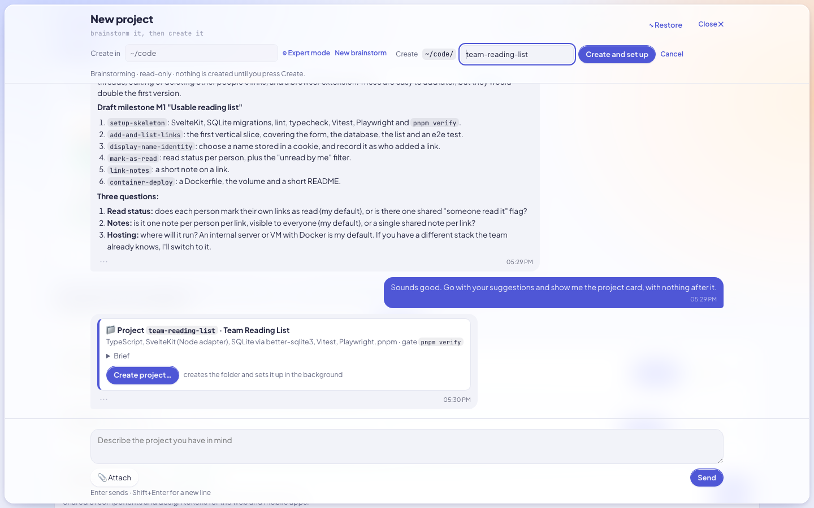

**⚙ Expert mode** (next to the folder) sets the workflow the new project starts with, as toggle chips with sensible
defaults; **+ add** takes your own entries:

- **Quality gates**: build and unit tests, linting, type checks, integration and end-to-end tests, coverage,
  mutation testing, architecture rules, vulnerability and license scans, performance budgets;
- **Checked for every task**: e.g. a test proves it, the quality gate is green, no TODOs;
- **Reviewed for every change**: e.g. matches the specs, security, error handling, test quality, accessibility,
  API compatibility, migrations;
- **Workflow steps**: one commit per ticket, acceptance check, diff review with validated findings, docs and
  diagram updates, parking lot;
- **Branches** (choose one): everything on main (the default), a branch per ticket that is merged when the ticket is
  done, or a branch per milestone that is merged when the milestone is done;
- **Documentation**: e.g. a README with setup and usage, CLAUDE.md / AGENTS.md kept current, an architecture
  overview, decision records (ADRs), an API reference, a user guide, a changelog, diagrams of the architecture and
  the main flows;
- **Diagram format** (choose one): Mermaid (the default; GitHub renders it), PlantUML, or both;
- **Diagram types**: which diagrams the project draws and keeps current, e.g. system context and containers (C4),
  components, sequence diagrams of the main flows, the data model (ER), state machines, activity or flow charts,
  deployment, class diagrams;
- **Container engine** (choose one): Podman (the default), Docker, or none (install on the host);
- **Tools and services**: tools that are not installed on the host run in a container; check the local containers
  and images for services to reuse before installing anything; dev services in a compose file; pinned image
  versions;
- **Version control** (choose one): git, local only (the default); git on GitHub, on GitLab or on another platform;
  or no version control;
- **Repository visibility** (choose one, only with a platform): private (the default) or public;
- **License** (choose one): none yet (the default), MIT, Apache-2.0, BSD-3-Clause, MPL-2.0, GPL-3.0-or-later,
  AGPL-3.0-or-later, or proprietary.

Claude gets them with your next message and plans with them (the first ticket sets up the chosen gates). **Create**
makes them binding: they go into the project's `openspec/config.yaml` (the quality gate, the rules for tasks, what
every review covers, the documentation, the diagram format and types) and its CLAUDE.md. Your choices are remembered for the
next project. Create also sets up version control as chosen (no `git init` without it) and adds the license: a
`LICENSE` file with its text and the SPDX identifier in the README. With a platform, the hosting goes into
CLAUDE.md, and the panel of the new project offers **Create it on GitHub**: an empty repository of the chosen
visibility, made with the GitHub CLI (`gh`, signed in) and added as `origin`; nothing is pushed, and a public one
asks first. For GitLab and other platforms the panel says what to run.

With the container check on, the dashboard adds the list of your local containers and images to the message (it
only lists them; nothing is started), and Claude suggests what fits, e.g. the Postgres that is already running for
the database and a mail catcher for the e-mails, instead of installing something on the host. The message shows
📦 for it; hover it to see the list. Once the choices went with a message, the panel folds into one line, so the
brainstorm has the room again; **Show** opens it.

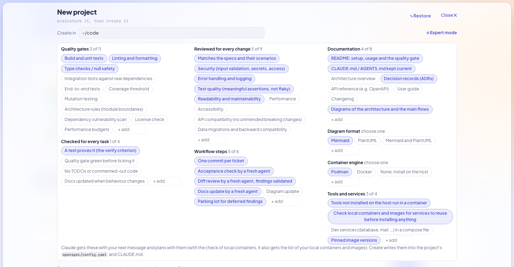

**📎 Attach** (next to Send, or drop files on the panel) sends files with your message: a spec, notes, a sketch, a
PDF, up to 5 files of 10 MB each. Claude reads them together with what you write; the message shows them as 📎.
**Create** hands them to the setup as part of the brief, so CLAUDE.md, the configuration and the first tickets take
them into account. The files stay in the dashboard's state folder (`~/.local/state/openspec-dashboard/attachments`)
and are not copied into the project.

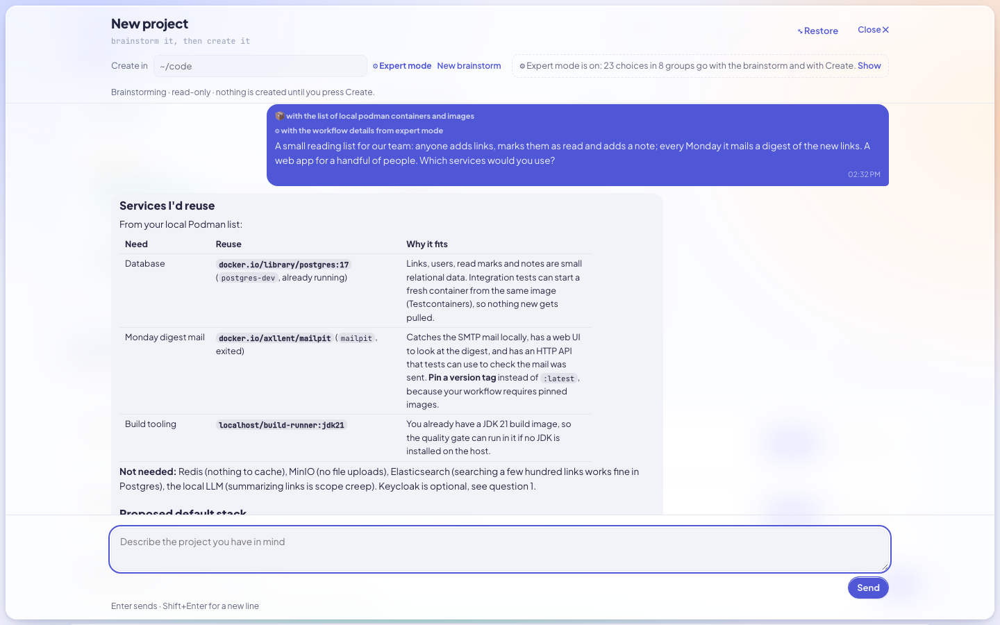

## Styles

The dashboard has ten styles:

| Style | Look |
|---|---|
| **Flat** (default) | clean and quiet |
| **Glass** | frosted panels over a soft colour field |
| **Clay** | warm ivory and terracotta with serif headings, close to the look of Claude; warm charcoal in dark mode |
| **Paper** | post-its on light wooden boards, one colour per column, the current task on a sticky note |
| **Whiteboard** | marker on a framed whiteboard, cards held by magnets; a dark glass board in dark mode |
| **Blackboard** | chalk on a green board in a wooden frame; always dark |
| **Notebook** | squared paper with a red margin line, handwritten headings, quiet cards |
| **Matrix** | falling green code behind glowing panels; always dark; the rain stops with reduced motion |
| **Terminal** | retro green-screen CRT with scanlines and a blinking cursor; always dark |
| **Comic** | halftone dots, thick ink outlines, the current task in a speech bubble |

**☰** at the end of the header holds the style picker, **◐ Switch** for light and dark, and the settings; both
choices are remembered per browser. In a link, `?style=<name>` (lower case, e.g. `notebook`) and `?theme=light|dark` set them, e.g.
http://127.0.0.1:4590/?style=paper&theme=dark.

| Flat, light | Flat, dark | Glass, dark |
|---|---|---|
| 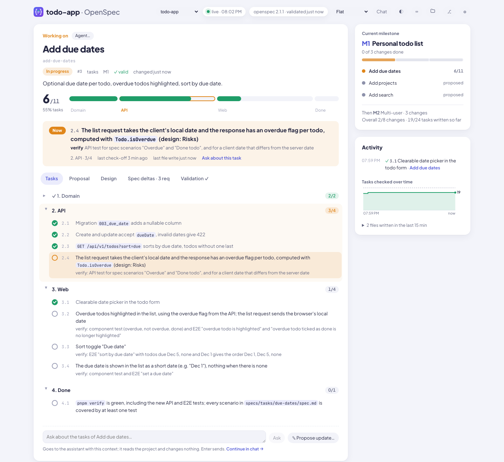 |  |  |

| Clay, light | Clay, dark |
|---|---|
| 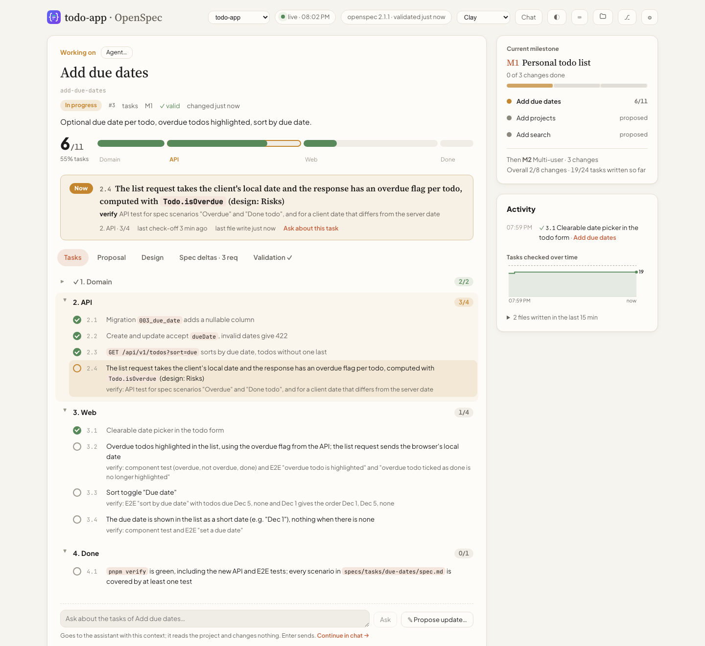 |  |

| Paper, light | Paper, dark |
|---|---|
|  |  |
|  | 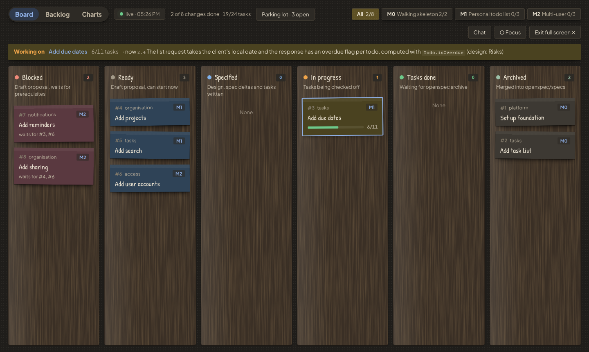 |

| Whiteboard, light | Whiteboard, dark |
|---|---|
|  |  |
|  | 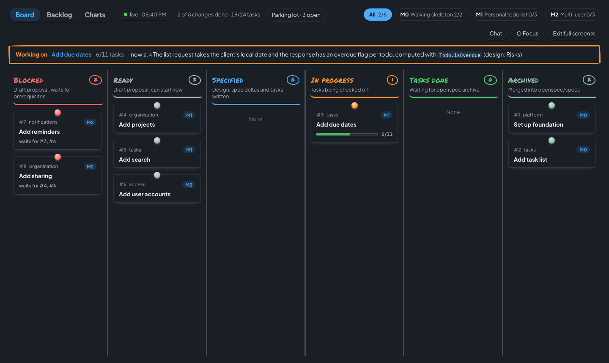 |

| Blackboard | Blackboard, board in full screen |
|---|---|
|  |  |

| Notebook, light | Notebook, dark |
|---|---|
|  |  |

| Matrix | Terminal |
|---|---|
|  | 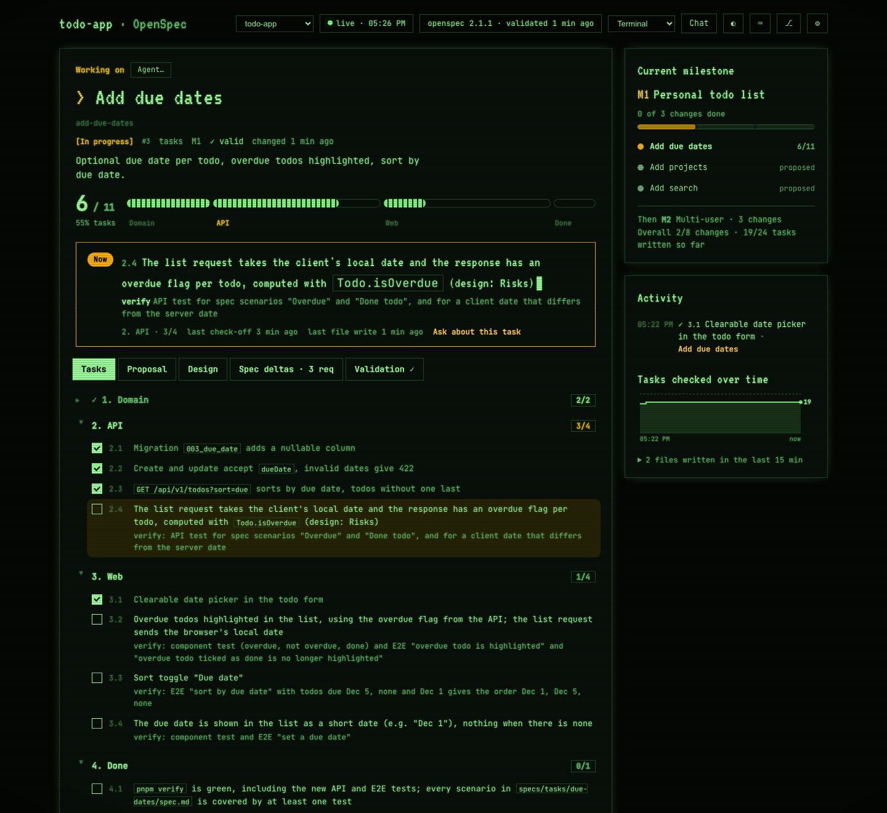 |

| Comic, light | Comic, dark |
|---|---|
| 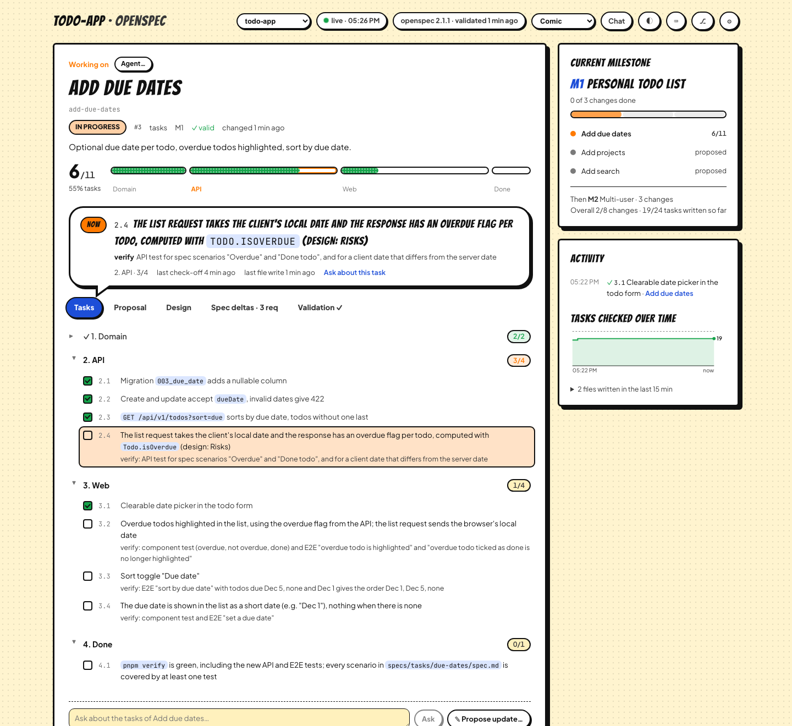 |  |

## Tips

- If OpenSpec runs in a container or behind a wrapper, start the dashboard with `--cli=<wrapper>`.
- The dashboard never writes to your project, except with `--agent` when you reorder the backlog or save a
  ticket or an idea. Its history
  lives in `~/.local/state/openspec-dashboard/`.
- Ticket by ticket, `openspec/specs/` becomes the description of what the system does today; point new team
  members and new agents there first.
- More options: [dashboard README](../tools/openspec-dashboard/README.md). The skill itself:
  [SKILL.md](../skills/openspec-ticket-workflow/SKILL.md).
